# Alur Sistem

## 1. Tujuan Dokumen

Dokumen ini menjelaskan alur operasional utama **Biometric Attendance & HR Management System**, mulai dari pengelolaan karyawan dan perangkat biometrik, pencatatan absensi, koreksi kehadiran, pengajuan izin, perhitungan lembur, hingga finalisasi payroll.

Dokumen ini menjadi acuan untuk implementasi backend, frontend, integrasi perangkat IoT, dan pengujian QA.

### 1.1 Penanda Status

- **Disepakati:** keputusan bisnis yang sudah ditetapkan.
- **Usulan:** alur yang direncanakan dan masih dapat berubah.
- **[MESIN]:** alur bergantung pada kemampuan perangkat keras atau firmware.
- **[KONFIRMASI]:** membutuhkan keputusan lebih lanjut dari klien.

---

## 2. Aktor Sistem

| Aktor | Tanggung jawab utama |
|---|---|
| Owner | Mengelola aturan perusahaan, tarif, bonus, dan akses sesuai kewenangannya |
| HR/Finance | Mengelola data karyawan, memeriksa absensi, memverifikasi lembur, dan memproses payroll sesuai izin |
| Karyawan | Melakukan absensi dan, jika fitur diaktifkan, mengajukan izin atau melihat informasi miliknya |
| Mesin absensi | Membaca sidik jari dan mengirimkan kejadian scan ke backend |
| Backend | Memvalidasi data, menyimpan scan, memproses aturan bisnis, mengatur akses, dan menyediakan data untuk frontend |

Kebutuhan persetujuan tambahan, akses per cabang, dan hak akses khusus masih mengikuti keputusan akses yang akan dikonfirmasi.

---

## 3. Arsitektur Alur Umum

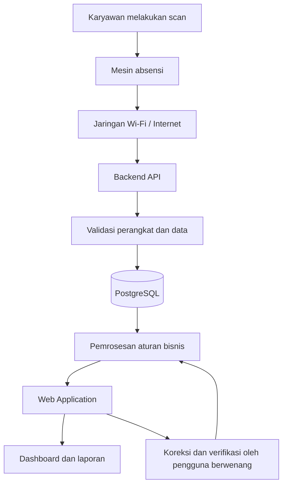

**Prinsip arsitektur:**

1. Frontend tidak berkomunikasi langsung dengan mesin atau database.
2. Backend menjadi pintu masuk integrasi mesin sekaligus pusat validasi aturan bisnis.
3. Data scan asli disimpan terpisah dari hasil interpretasi absensi.
4. Data kehadiran yang dikoreksi harus memiliki jejak audit.
5. Backend menjadi sumber kebenaran untuk perhitungan absensi dan payroll.
6. Dukungan penyimpanan offline, pengiriman ulang, dan sinkronisasi bergantung pada kemampuan firmware mesin.

---

## 4. Alur Pendaftaran Karyawan dan Sidik Jari

### 4.1 Alur Utama

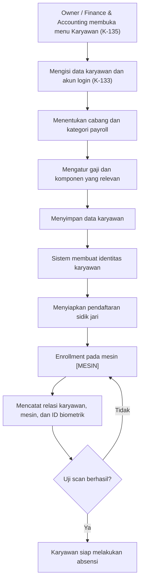

### 4.2 Ketentuan

1. Data karyawan harus tersimpan sebelum relasi biometrik dibuat.
2. Setiap karyawan memiliki identitas internal yang stabil.
3. Relasi biometrik harus mengidentifikasi karyawan dan perangkat tempat sidik jari didaftarkan.
4. Enrollment harus dilakukan melalui mekanisme yang didukung mesin.
5. Sistem harus menyediakan status pendaftaran biometrik, seperti belum didaftarkan, menunggu, berhasil, atau gagal, sesuai kemampuan integrasi.
6. Enrollment tidak boleh dianggap berhasil sebelum terdapat konfirmasi yang dapat dipercaya dari perangkat atau proses verifikasi yang ditetapkan.

**[KONFIRMASI]** Belum dipastikan apakah enrollment dipicu dari web atau dilakukan langsung di mesin, bagaimana ID sidik jari dikelola, dan apakah mesin mendukung penghapusan biometrik melalui server.

Data biometrik harus dilindungi sesuai kebijakan keamanan dan privasi yang ditetapkan untuk proyek ini.

---

## 5. Alur Scan hingga Dashboard

### 5.1 Alur Pengiriman Scan

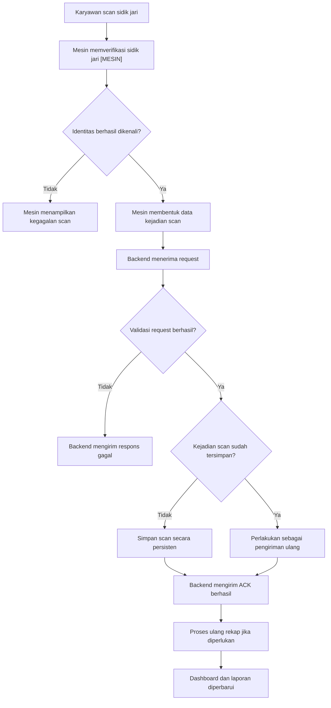

### 5.2 Data Scan Minimal

Data yang perlu tersedia dalam kontrak integrasi, sesuai kemampuan perangkat, mencakup:

- Identitas unik kejadian scan.
- Identitas perangkat.
- Identitas karyawan atau ID biometrik yang dapat dipetakan ke karyawan.
- Waktu scan.
- Informasi tambahan yang dibutuhkan untuk validasi dan audit.

Format final bergantung pada protokol perangkat yang dipilih.

### 5.3 Ketentuan Integrasi

1. Backend harus memvalidasi perangkat dan format request.
2. Backend harus mencegah satu kejadian scan dihitung dua kali.
3. Backend hanya mengirim ACK berhasil setelah data scan tersimpan secara persisten.
4. Jika penyimpanan gagal, backend tidak boleh menyatakan bahwa scan berhasil tersimpan.
5. Mesin harus dapat membedakan respons berhasil dan gagal sesuai protokol integrasi.
6. Pengiriman ulang harus mempertahankan identitas kejadian yang sama agar idempotensi dapat diterapkan.
7. Rekap absensi dapat diproses ulang ketika scan baru atau koreksi yang sah diterima.

**[MESIN]** Penyimpanan offline, antrean pengiriman, sinkronisasi setelah koneksi pulih, dan pencatatan waktu menggunakan RTC belum dianggap tersedia sebelum kemampuan perangkat dan firmware dikonfirmasi.

---

## 6. Alur Pembentukan Rekap Absensi Harian

### 6.1 Alur Pemrosesan

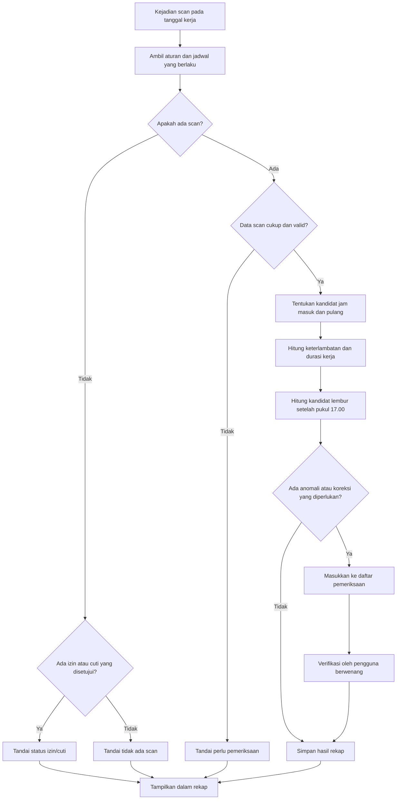

### 6.2 Aturan Pembentukan Rekap

- Sistem memproses scan berdasarkan tanggal kerja, identitas karyawan, dan jadwal yang berlaku.
- Scan pertama dan terakhir dapat digunakan sebagai kandidat jam masuk dan pulang jika kebijakan ini dikonfirmasi serta data scan memenuhi syarat.
- Satu scan saja tidak cukup untuk menyimpulkan jam masuk dan pulang secara lengkap.
- Scan yang tidak wajar, data duplikat, atau data yang tidak dapat dipetakan harus ditandai untuk pemeriksaan.
- Status tidak ada scan tidak otomatis berarti mangkir sebelum mempertimbangkan izin, cuti, jadwal kerja, dan aturan yang berlaku.
- Status kehadiran dan kelayakan upah harian merupakan dua hal yang berkaitan tetapi tidak identik.
- Rekap dapat berubah ketika data baru diterima atau koreksi resmi dilakukan, kecuali perubahan tersebut dibatasi oleh status final payroll dan prosedur koreksi yang berlaku.

### 6.3 Perhitungan Waktu

Sistem menggunakan aturan jadwal yang berlaku pada tanggal kerja terkait untuk menghitung:

- Keterlambatan.
- Jam masuk dan pulang aktual.
- Durasi kerja berdasarkan aturan istirahat.
- Kekurangan waktu kerja jika relevan.
- Kandidat lembur.
- Status data yang belum lengkap atau memerlukan pemeriksaan.

**Disepakati:** batas awal perhitungan kandidat lembur pada hari kerja normal adalah pukul 17.00, tanpa syarat harus menyelesaikan delapan jam kerja terlebih dahulu.

**[KONFIRMASI]** Detail jam istirahat, pembulatan, hari libur, dan penanganan scan lintas tengah malam harus ditetapkan sebelum rumus final digunakan.

---

## 7. Alur Koreksi Absensi

### 7.1 Alur Koreksi

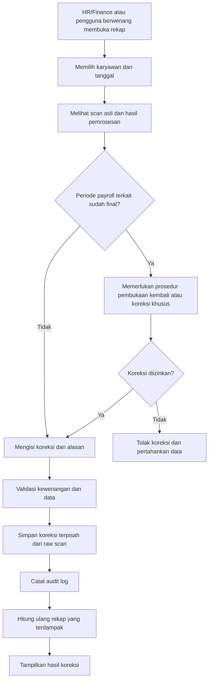

### 7.2 Ketentuan Koreksi

1. Koreksi hanya dapat dilakukan oleh pengguna berwenang.
2. Alasan koreksi wajib diisi.
3. Raw scan tidak boleh ditimpa atau dihapus akibat koreksi.
4. Sistem menyimpan nilai sebelum dan sesudah koreksi.
5. Sistem mencatat pengguna, waktu, alasan, dan objek yang dikoreksi.
6. Hasil rekap dihitung ulang berdasarkan koreksi yang sah.
7. Jika payroll sudah final, koreksi tidak boleh diam-diam mengubah hasil payroll sebelumnya.
8. Koreksi yang berdampak pada payroll final harus mengikuti prosedur pembukaan kembali atau penyesuaian yang telah ditetapkan.

**[KONFIRMASI]** Kewenangan final untuk koreksi, kebutuhan persetujuan kedua, dan prosedur koreksi setelah payroll dibayarkan perlu disepakati.

---

## 8. Alur Izin dan Cuti

### 8.1 Alur Pengajuan

Status dan transisi (K-113). Hanya jenis izin yang ditandai Owner melewati `PERLU_TINJAU_OWNER`; jenis lain langsung `DISETUJUI` setelah tahap HR.

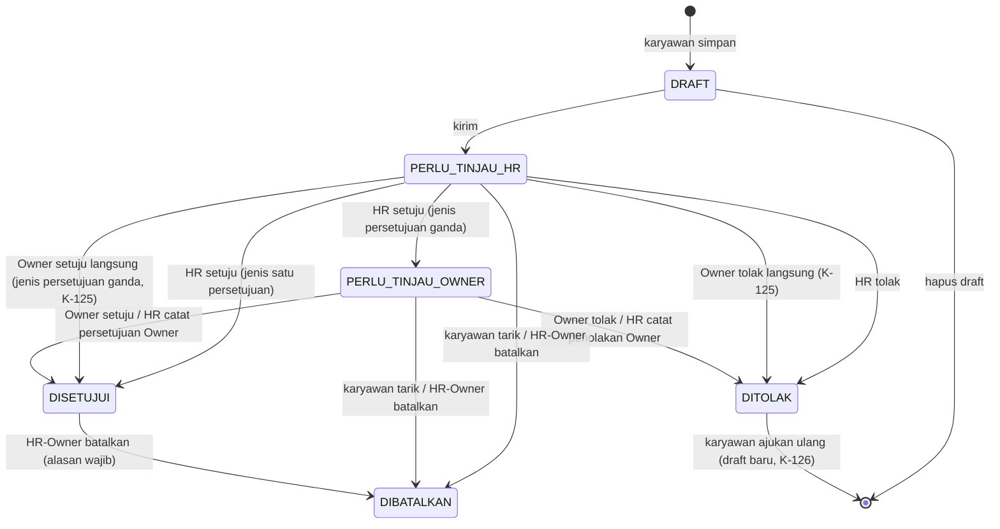

### 8.2 Ketentuan

- Pengajuan memiliki identitas karyawan, jenis, tanggal atau rentang tanggal, alasan, dan status.
- Dokumen pendukung dapat diwajibkan sesuai jenis pengajuan.
- Pengajuan yang belum disetujui tidak boleh otomatis diperlakukan sebagai izin yang sah. Draft tidak memengaruhi rekap maupun pengecekan tumpang tindih.
- Tidak ada yang memutus pengajuannya sendiri di tahap mana pun (K-079).
- Pada jenis persetujuan ganda, Owner boleh langsung menyetujui atau menolak tanpa menunggu tahap HR. Keputusan tercatat satu baris tahap Owner, dan surat menuliskan tahap HR sebagai "diputus langsung oleh Owner" (K-125).
- HR boleh mencatat keputusan Owner yang diberikan di luar web (WhatsApp, lisan, tertulis) beserta waktu, catatan, dan bukti (K-117).
- Surat berupa PDF dari server, memuat QR ke halaman verifikasi publik `/verifikasi/<token>` (K-114, K-116).
- Persetujuan atau penolakan harus tercatat.
- Pengajuan yang disetujui dapat memengaruhi status rekap absensi.
- Dampak izin, sakit, dan cuti terhadap upah atau gaji mengikuti kebijakan perusahaan.

**[KONFIRMASI]** Jenis izin/cuti, kuota cuti, kebutuhan dokumen, dan konsekuensi payroll belum ditetapkan secara final.

Jika fitur pengajuan mandiri karyawan belum masuk ke tahap implementasi pertama, alur ini dapat dimulai melalui pencatatan oleh HR/Finance.

---

## 9. Alur Verifikasi dan Perhitungan Lembur

### 9.1 Alur Lembur

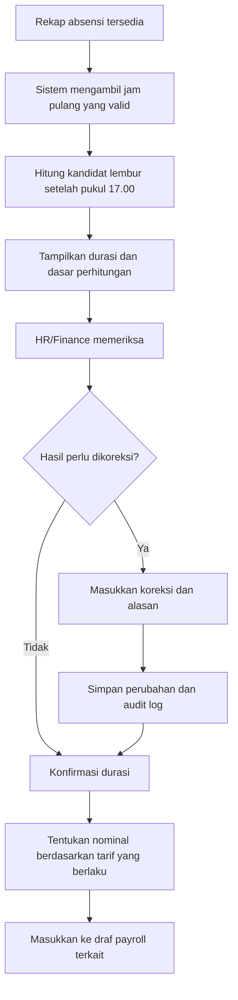

**Status implementasi (K-140, 2026-10-28):** langkah "HR/Finance memeriksa" dan "Konfirmasi durasi" sudah diimplementasikan di menu **Validasi Lembur** (`/absensi/lembur`). Kandidat diambil dari rekap harian; Owner atau Finance & Accounting menyetujui seluruhnya, mengurangi, atau menolak (0 menit) dengan catatan wajib bila dikurangi/ditolak, tanpa pembulatan. Koreksi jam tetap lewat koreksi absensi (K-059); bila koreksi mengubah kandidat, lembur berstatus "Perlu validasi ulang" dan belum dihitung. Langkah nominal/tarif dan draf payroll belum (menunggu Fase 5).

### 9.2 Ketentuan

1. Durasi lembur awal dihitung dari waktu setelah pukul 17.00.
2. Perhitungan menggunakan catatan absensi yang valid atau telah dikoreksi secara sah.
3. Sistem harus menampilkan durasi dan tarif yang digunakan agar hasil dapat diverifikasi.
4. Koreksi manual harus memiliki alasan dan jejak audit.
5. Nominal lembur dihitung menggunakan tarif yang berlaku pada periode terkait.
6. Sistem tidak boleh menggunakan tarif terbaru untuk menggantikan tarif historis yang sudah digunakan dalam payroll final.
7. Penyesuaian istirahat, hari libur, pembulatan, dan kategori karyawan mengikuti kebijakan yang sudah dikonfirmasi.

Pengajuan atau persetujuan lembur sebelum pekerjaan dilakukan belum menjadi prasyarat yang disepakati. Jika perusahaan mewajibkan persetujuan tersebut, alur perlu ditambahkan.

---

## 10. Alur Penggajian

### 10.1 Gambaran Umum

Sistem mendukung dua periode payroll:

- Mingguan untuk supir dan kenek.
- Bulanan untuk karyawan lainnya.

Untuk staf bulanan, gaji pokok dipisahkan dari upah harian. Sistem tidak boleh menggabungkan kedua komponen tersebut tanpa mempertahankan rincian masing-masing.

### 10.2 Alur Payroll

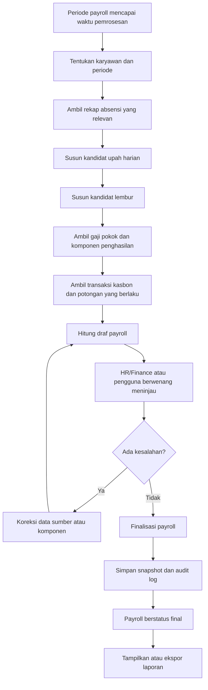

### 10.3 Komponen Perhitungan

Untuk staf bulanan, struktur perhitungan konseptual:

`Payroll Bersih = Gaji Pokok + Upah Harian Disetujui + Lembur Disetujui + Bonus/Komponen Tambahan - Potongan Disetujui`

Untuk supir dan kenek:

`Payroll Bersih = Upah Harian Disetujui + Lembur Disetujui + Bonus/Komponen Tambahan - Potongan Disetujui`

Komponen hanya dimasukkan apabila berlaku untuk karyawan dan periode tersebut. BPJS, PPh 21, dan potongan lain tidak boleh otomatis diterapkan sebelum kebijakannya dikonfirmasi.

### 10.4 Upah Harian

Sistem menghasilkan usulan upah harian berdasarkan aturan kehadiran dan kriteria yang berlaku. Pengguna berwenang memeriksa serta menentukan kelayakan pembayaran sesuai kebijakan perusahaan.

Sistem harus mempertahankan rincian hari yang dibayar, tarif yang digunakan, serta dasar penetapannya.

### 10.5 Kasbon

Kasbon diambil dari ledger transaksi yang tercatat. Setiap pengurangan kasbon pada payroll harus dapat ditelusuri ke transaksi dan aturan pemotongan yang disetujui.

Saldo kasbon tidak boleh diubah hanya untuk menyesuaikan hasil payroll tanpa transaksi yang dapat diaudit.

### 10.6 Finalisasi

Ketika payroll difinalisasi, sistem harus menyimpan snapshot perhitungan yang mencakup tarif, aturan, komponen, input, hasil, dan identitas pelaku finalisasi.

Snapshot menjadi dasar untuk menjelaskan hasil payroll historis walaupun aturan perusahaan kemudian berubah.

---

## 11. Alur Pembukaan Kembali Payroll

### 11.1 Prinsip

Payroll final dapat dibuka kembali hanya melalui prosedur terkontrol. Pembukaan kembali tidak boleh menghapus snapshot atau riwayat finalisasi sebelumnya.

### 11.2 Alur

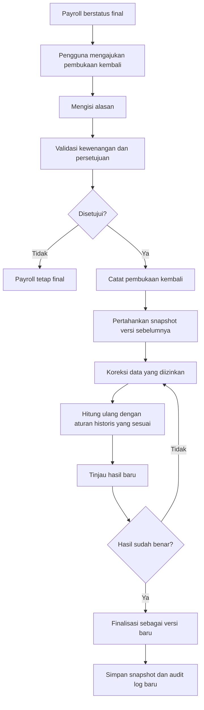

### 11.3 Ketentuan

- Snapshot payroll sebelumnya tetap tersedia.
- Pembukaan kembali harus memiliki pelaku, waktu, dan alasan.
- Koreksi yang dilakukan harus dapat ditelusuri.
- Perhitungan ulang harus menggunakan tarif dan aturan yang sesuai dengan periode historis.
- Finalisasi ulang membuat versi baru tanpa menghilangkan versi sebelumnya.
- Prosedur penyesuaian jika gaji sudah dibayarkan harus ditetapkan terpisah.

**[KONFIRMASI]** Pihak yang boleh membuka kembali payroll dan apakah dibutuhkan persetujuan Owner masih harus disepakati.

---

## 12. Alur Perubahan Tarif dan Aturan

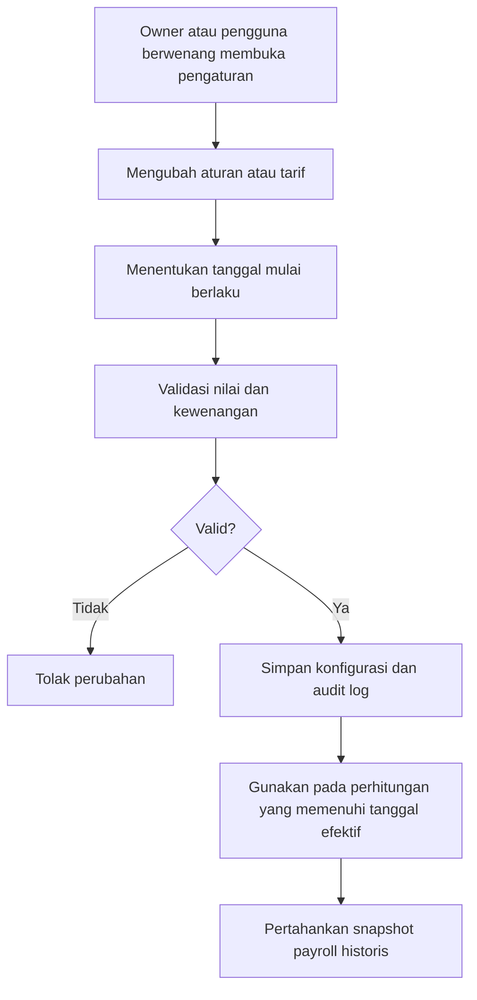

Contoh: tarif upah harian Rp80.000 berlaku sampai September dan Rp100.000 mulai Oktober. Payroll September yang dibuka kembali tetap menggunakan tarif historis September, kecuali terdapat koreksi retroaktif yang disetujui dan tercatat secara resmi.

Perubahan konfigurasi tidak boleh langsung memperbarui hasil payroll final yang sudah tersimpan.

---

## 13. Alur Karyawan Keluar

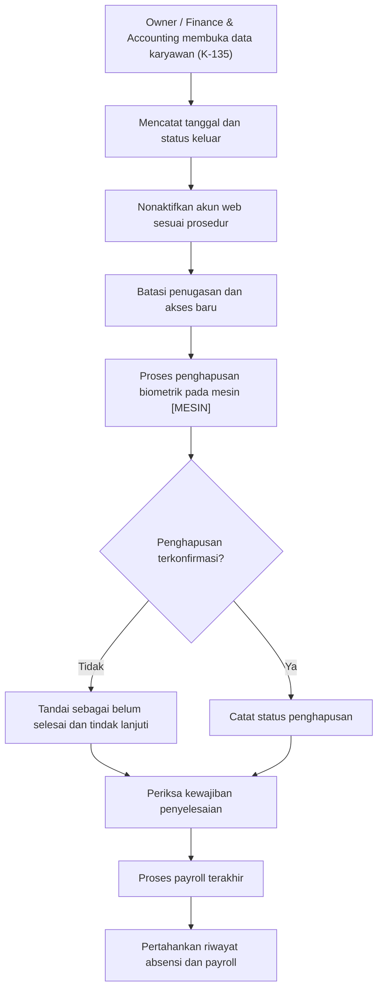

### 13.1 Ketentuan

1. Karyawan yang keluar tidak boleh tetap memiliki akses akun yang aktif setelah tanggal efektif penonaktifan.
2. Relasi biometrik harus ditangani sesuai kemampuan perangkat dan prosedur penghapusan.
3. Jika mesin tidak dapat dihubungi, status penghapusan harus ditandai belum selesai, bukan dianggap berhasil.
4. Riwayat absensi dan payroll tetap dipertahankan sesuai kebijakan retensi data.
5. Payroll terakhir mengikuti periode dan aturan yang berlaku.
6. Penghapusan akun tidak boleh otomatis menghapus riwayat transaksi keuangan atau audit.

**[KONFIRMASI]** Mekanisme penghapusan sidik jari, retensi data biometrik, dan lama penyimpanan data karyawan yang keluar belum ditetapkan.

---

## 14. Alur Penanganan Gangguan Perangkat

### 14.1 Perangkat Tidak Terhubung

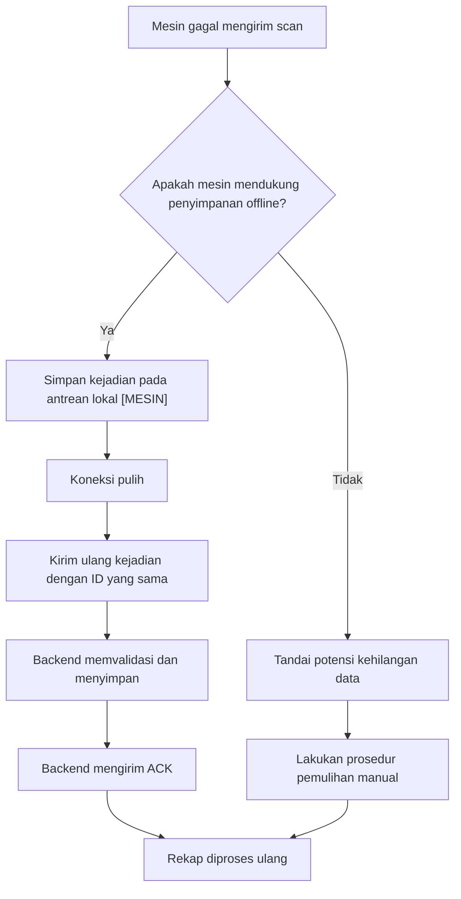

### 14.2 Prinsip Penanganan

- Kegagalan koneksi tidak boleh dianggap sebagai scan berhasil tersimpan di server.
- Pengiriman ulang harus aman terhadap duplikasi.
- Jika perangkat tidak mendukung antrean offline, diperlukan prosedur pemulihan yang disetujui.
- Scan manual yang dimasukkan sebagai pemulihan harus dibedakan dari scan mesin dan dicatat melalui audit.
- Waktu scan harus menggunakan referensi waktu yang disepakati.
- Monitoring perangkat dan indikator terakhir terhubung perlu disediakan jika protokol mendukungnya.

**[KONFIRMASI]** Kapasitas offline, RTC, protokol ACK, mekanisme retry, dan metode sinkronisasi belum dipastikan.

---

## 15. Alur Laporan dan Rekonsiliasi

Sistem harus menyediakan laporan yang dapat ditelusuri kembali ke sumber perhitungannya.

Empat laporan utama yang menjadi acuan pengujian:

1. Absensi dan payroll mingguan supir/kenek.
2. Laporan lembur supir/kenek.
3. Absensi dan payroll bulanan karyawan staf.
4. Laporan lembur bulanan karyawan staf.

Alur umum:

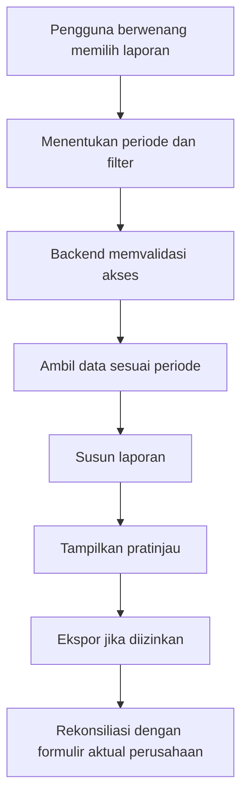

Setiap laporan payroll harus konsisten dengan snapshot payroll yang bersangkutan. Laporan historis tidak boleh berubah hanya karena aturan atau tarif untuk periode baru telah diperbarui.

Format, kolom, dan rumus final laporan mengikuti formulir aktual perusahaan yang telah disetujui.

---

## 16. Status Proses yang Disarankan

Status berikut merupakan rancangan awal dan perlu diselaraskan dengan kebutuhan implementasi.

| Modul | Status yang disarankan |
|---|---|
| Karyawan | Aktif, nonaktif |
| Pendaftaran biometrik | Belum didaftarkan, menunggu, berhasil, gagal |
| Perangkat | Aktif, tidak terhubung, gangguan |
| Rekap absensi | Normal, terlambat, tidak lengkap, perlu pemeriksaan, izin/cuti, tidak ada scan |
| Koreksi absensi | Diajukan, diproses, diterapkan, ditolak |
| Izin/cuti | Draft, perlu ditinjau HR, perlu ditinjau Owner, disetujui, ditolak, dibatalkan |
| Verifikasi lembur | Perlu pemeriksaan, disetujui, dikoreksi |
| Payroll | Draf, dalam peninjauan, final, dibuka kembali, difinalisasi ulang |
| Kasbon | Tercatat, sebagian dilunasi, lunas |
| Penghapusan biometrik | Belum diproses, menunggu konfirmasi, berhasil, gagal |

Status harus merepresentasikan kondisi nyata di backend. Frontend tidak boleh mengubah status final tanpa tindakan backend yang sah.

---

## 17. Validasi Sebelum Implementasi Final

Hal-hal berikut harus dikonfirmasi atau diselesaikan sebelum alur terkait dianggap final:

1. Pemilihan sensor, mikrokontroler, dan protokol komunikasi.
2. Lokasi penyimpanan template sidik jari dan proses pencocokan biometrik.
3. Mekanisme enrollment dan penghapusan sidik jari.
4. Kemampuan mesin menyimpan data saat offline, retry, dan RTC.
5. Hari kerja, jam istirahat, toleransi keterlambatan, dan perlakuan hari libur.
6. Metode penentuan scan masuk/pulang dan penanganan scan tidak lengkap.
7. Tarif lembur, pembulatan, serta proses verifikasinya.
8. Periode payroll, komponen penghasilan, potongan, dan kebijakan kasbon.
9. Hak akses koreksi absensi, finalisasi, dan pembukaan kembali payroll.
10. Prosedur koreksi payroll yang sudah dibayarkan.
11. Format empat laporan aktual perusahaan.
12. Kebijakan perlindungan dan retensi data biometrik.

Rincian pertanyaan dan status konfirmasi dikelola di [`pertanyaan-terbuka.md`](./pertanyaan-terbuka.md).

---

## 18. Dokumen Terkait

- [`README.md`](./README.md) — navigasi dokumentasi proyek.
- [`PRD.md`](./PRD.md) — kebutuhan dan cakupan produk.
- [`kebutuhan.md`](./kebutuhan.md) — kebutuhan fungsional dan nonfungsional.
- [`arsitektur.md`](./arsitektur.md) — arsitektur aplikasi dan integrasi.
- [`aturan-bisnis.md`](./aturan-bisnis.md) — aturan perhitungan dan kebijakan bisnis.
- [`keputusan.md`](./keputusan.md) — keputusan yang telah ditetapkan.
- [`pertanyaan-terbuka.md`](./pertanyaan-terbuka.md) — hal yang masih memerlukan konfirmasi.
- [`rencana-pengerjaan.md`](./rencana-pengerjaan.md) — tahapan implementasi.
- [`design-system.md`](./design-system.md) — panduan antarmuka aplikasi.