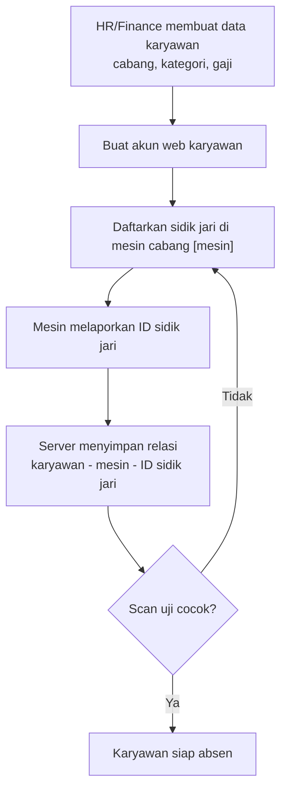
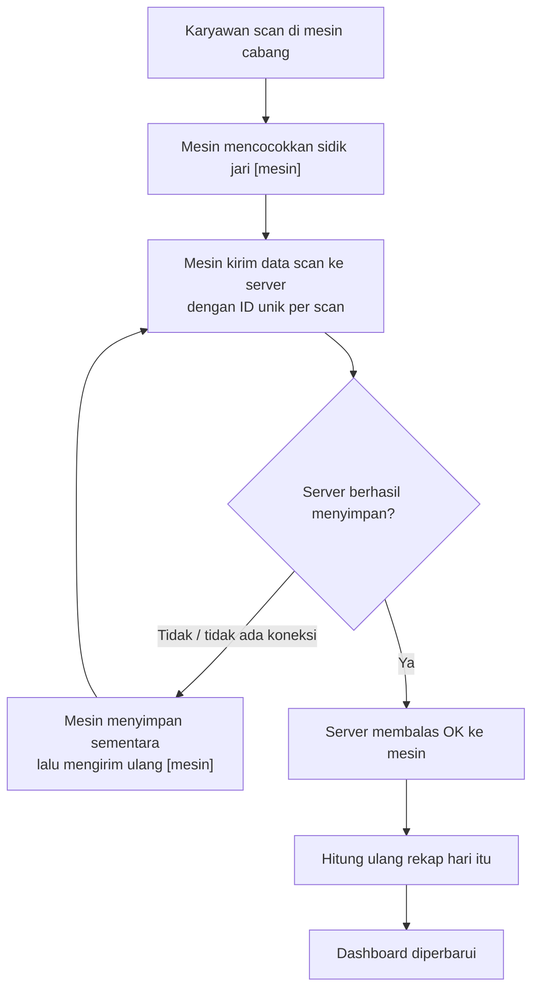
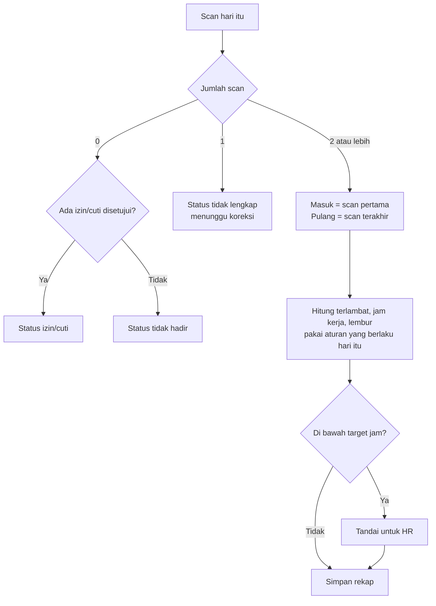
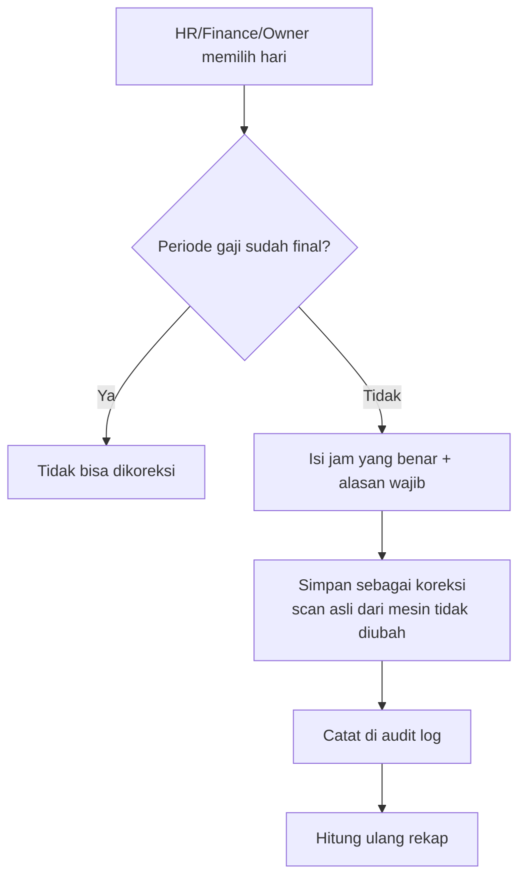
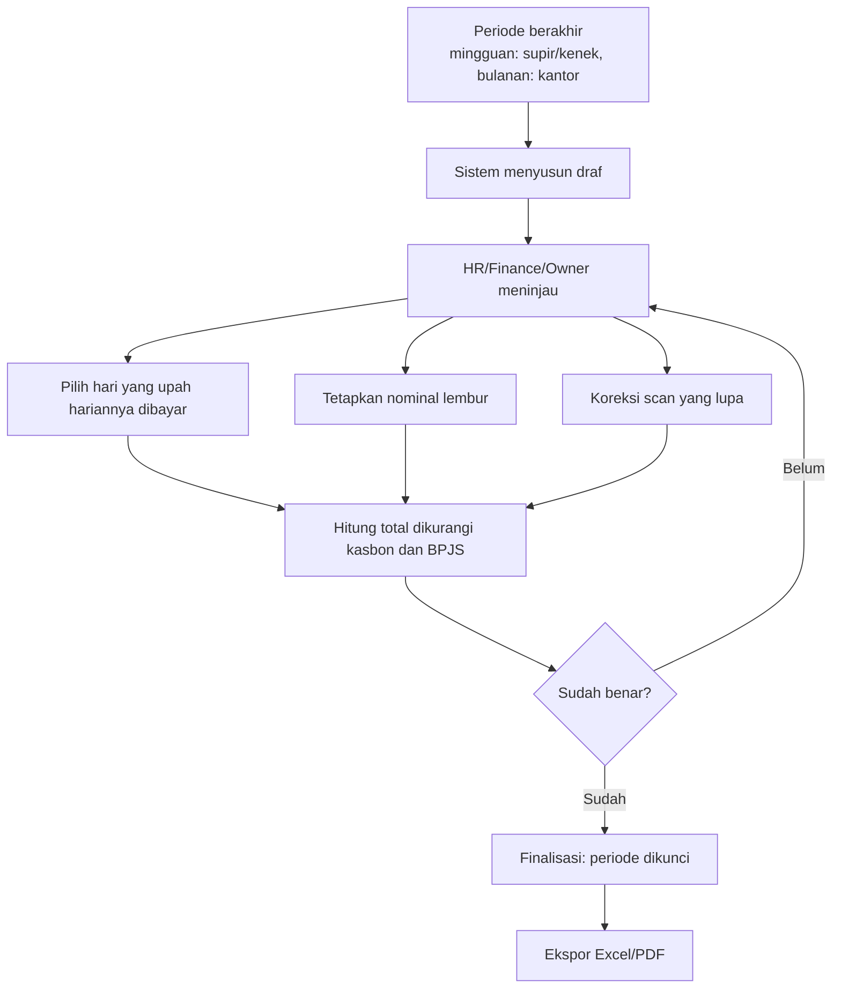
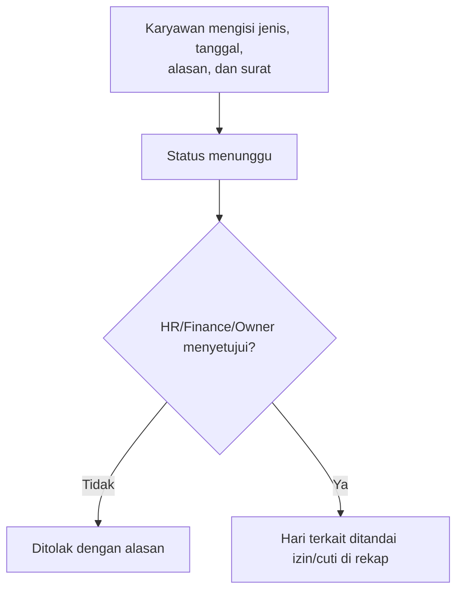
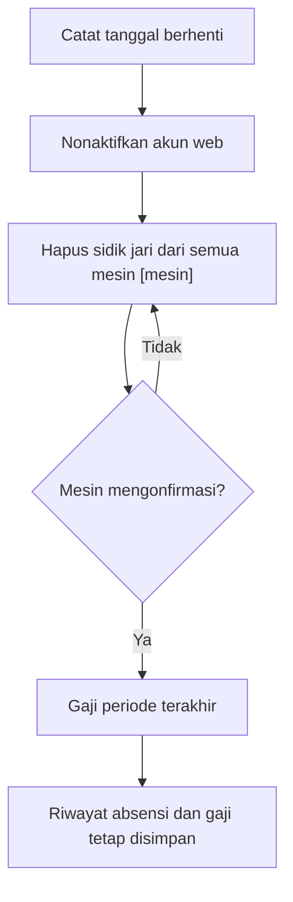

# Alur Utama

Langkah yang bergantung pada kemampuan mesin yang belum diketahui ditandai **[mesin]**.

## 1. Pendaftaran karyawan dan sidik jari

## 2. Dari scan sampai dashboard

Server **hanya** membalas OK setelah data benar-benar tersimpan. Kalau scan yang sama terkirim dua kali, scan itu disimpan sekali saja.

## 3. Rekap harian

## 4. Koreksi scan

Cara membuka kembali periode yang sudah final masih **usulan** dan belum dirancang.

## 5. Gaji per periode

## 6. Izin dan cuti

Jenis izin/cuti dan perlakuannya terhadap gaji **belum diketahui**.

## 7. Karyawan keluar

