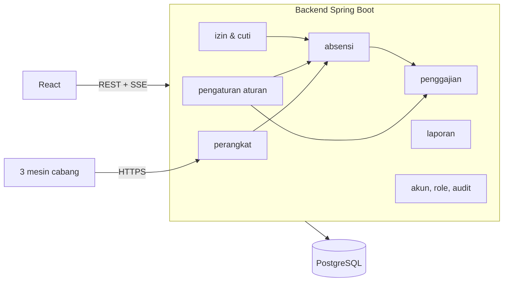

# Arsitektur

## Stack (disepakati 2026-10-09)

| Lapisan | Pilihan |
| --- | --- |
| Backend | Java LTS + Spring Boot (versi pasti ditetapkan saat setup proyek) |
| Database | PostgreSQL, migration dengan Flyway |
| Akses data | Spring Data JPA |
| Keamanan | Spring Security |
| Kontrak API | OpenAPI (springdoc) |
| Frontend | React + Vite + TypeScript |
| Real-time | Server-Sent Events |
| Ekspor | Apache POI (Excel) dan generator PDF |
| Test | JUnit 5, Testcontainers (PostgreSQL asli), MockMvc |
| Deployment | Docker Compose + reverse proxy dengan TLS. Hosting **belum diketahui** |

Pola arsitekturnya **modular monolith**: satu aplikasi backend yang dibagi per modul domain.

## Prinsip teknis

Prinsip di bawah sudah disepakati (lihat K-004, K-007, K-008 di [keputusan.md](keputusan.md)).

1. **Aturan bisnis tidak di-hardcode.** Perhitungan selalu membaca pengaturan yang berlaku pada tanggal kejadian (lihat [aturan-bisnis.md](aturan-bisnis.md)).
2. **Mesin perhitungan dibuat murni.** Fungsi hitung rekap harian dan gaji tidak bergantung pada database atau web, sehingga bisa diuji langsung dengan test case di aturan-bisnis.md.
3. **Scan asli tidak pernah diubah.** Koreksi disimpan sebagai data terpisah, dan rekap dihitung dari scan ditambah koreksi.
4. **Server hanya membalas OK setelah data tersimpan.** Setiap scan punya ID unik dari mesin, dan scan yang terkirim ulang tidak tersimpan dua kali.
5. **Setiap mesin punya kredensial sendiri** yang bisa dicabut. Mesin tidak diautentikasi hanya dari serial number seperti di eksperimen lama.
6. **Uang memakai `BigDecimal`.**
7. **Waktu disimpan dengan zona waktu yang jelas.** Zona waktu cabang dikonfigurasi (nilai awal `Asia/Jakarta`).
8. **Periode yang sudah final dikunci.**
9. **Audit log** untuk koreksi, perubahan nominal, perubahan aturan, perubahan akun, dan ekspor.

## Integrasi mesin

Komponen mesin **belum diketahui**. Sampai prototipe mesin siap:

- Dibuat **simulator mesin** (program kecil yang meniru mesin mengirim scan), sehingga web dan server bisa dikembangkan dan diuji tanpa hardware.
- Kontrak data mesin ke server ditulis sebagai draf dengan versi, lalu disesuaikan setelah kemampuan mesin diketahui.
- Kebutuhan minimal untuk mesin, sebagai masukan bagi tim hardware:
  - ID unik per scan
  - Jam yang akurat (RTC atau sinkron waktu)
  - Simpan sementara saat offline, lalu kirim ulang
  - Kirim lewat HTTPS
  - Heartbeat berkala
  - Bisa menghapus sidik jari atas perintah server
