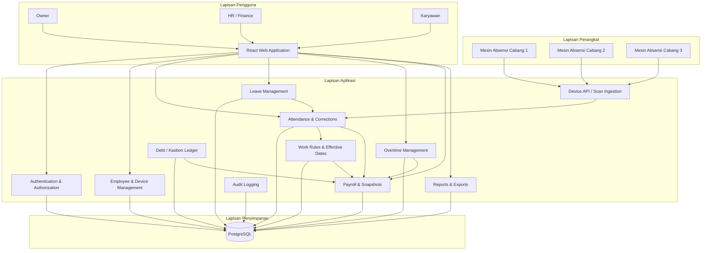
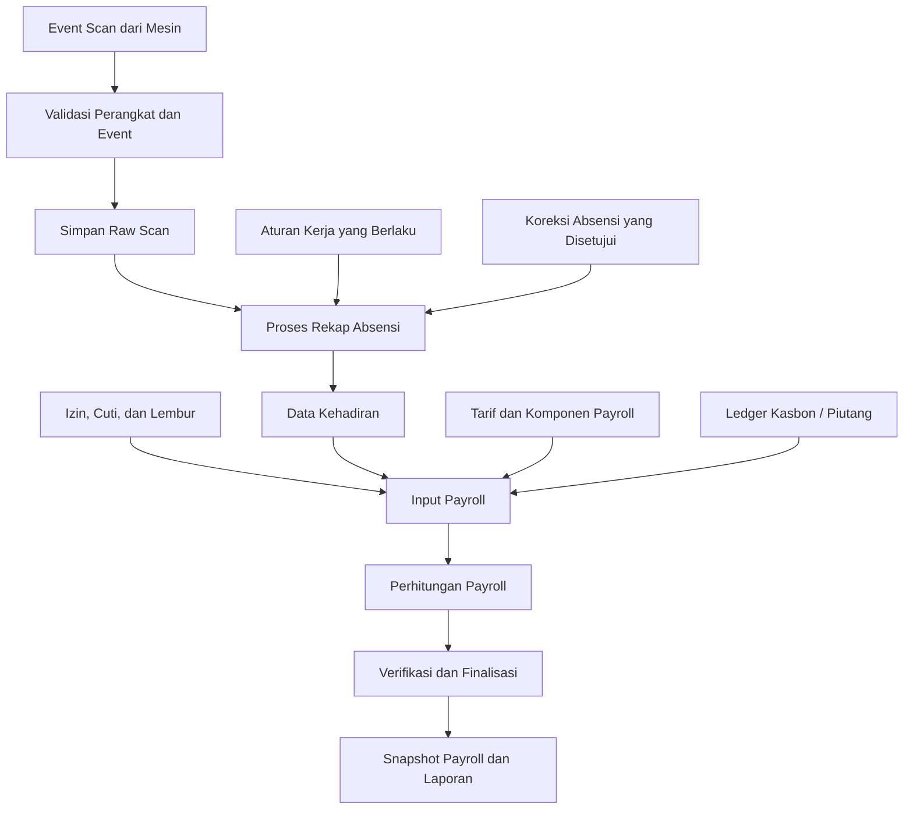
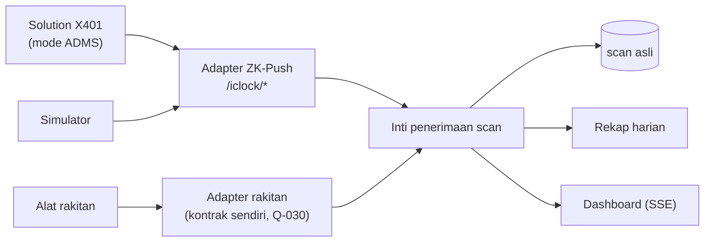

# Arsitektur Sistem

**Nama proyek:** Biometric Attendance & HR Management System  
**Status dokumen:** Arsitektur awal — sebagian keputusan menunggu validasi hardware dan klien  
**Pendekatan:** Modular Monolith

## 1. Tujuan Arsitektur

Dokumen ini menjelaskan rancangan teknis sistem absensi biometrik dan manajemen karyawan, meliputi:

- Struktur aplikasi frontend dan backend.
- Aliran data dari mesin absensi sampai laporan dan payroll.
- Pembagian modul domain.
- Integrasi mesin biometrik.
- Pengelolaan database dan konsistensi data.
- Keamanan, audit, dan perlindungan data.
- Strategi pengujian dan deployment.

Arsitektur harus memungkinkan pengembangan dimulai sebelum prototipe mesin selesai, tanpa membuat asumsi hardware yang belum dikonfirmasi.

## 2. Prinsip Arsitektur

1. **Modular monolith terlebih dahulu.** Backend berjalan sebagai satu aplikasi Spring Boot dengan batas modul domain yang jelas.
2. **Backend sebagai pusat otoritas.** Frontend dan mesin berkomunikasi dengan backend, bukan mengakses database secara langsung.
3. **Data scan asli tidak boleh diubah.** Koreksi absensi disimpan terpisah dan memiliki jejak audit.
4. **Aturan bisnis dapat dikonfigurasi.** Jam kerja, toleransi keterlambatan, dan aturan penggajian tidak boleh tersebar sebagai nilai hardcode di banyak tempat.
5. **Perhitungan dapat diuji secara terpisah.** Mesin perhitungan absensi dan payroll sebisa mungkin merupakan logika domain murni, terpisah dari database dan antarmuka.
6. **Setiap transaksi harus dapat ditelusuri.** Hasil absensi dan payroll dapat ditelusuri kembali ke scan, koreksi, aturan, tarif, dan komponen yang digunakan.
7. **Keamanan diterapkan di backend.** Menyembunyikan tombol di frontend bukan pengganti pemeriksaan izin akses di server.
8. **Keputusan yang belum tervalidasi tetap terbuka.** Khususnya protokol perangkat, penyimpanan template sidik jari, mekanisme offline, dan deployment.

## 3. Technology Stack

| Lapisan | Teknologi | Fungsi |
|---|---|---|
| Frontend | React + Vite + TypeScript | Antarmuka admin, HR/Finance, dan karyawan |
| UI | Tailwind CSS + shadcn/ui | Komponen dan sistem desain |
| Backend | Java LTS + Spring Boot | API, autentikasi, proses bisnis |
| Security | Spring Security | Autentikasi dan otorisasi |
| Session | Spring Session JDBC | Pengelolaan sesi login di database |
| Database | PostgreSQL | Penyimpanan data aplikasi |
| Database migration | Flyway | Versi dan perubahan skema database |
| Data access | Spring Data JPA | Akses data melalui repository |
| API contract | OpenAPI / springdoc | Dokumentasi kontrak API |
| Real-time | Server-Sent Events (SSE), bila sesuai | Pembaruan data pada dashboard |
| Excel | Apache POI | Impor atau ekspor Excel |
| PDF | Library generator PDF yang ditetapkan saat implementasi | Dokumen dan laporan PDF |
| Backend testing | JUnit 5, MockMvc, Testcontainers | Unit test dan pengujian integrasi |
| Build backend | Maven | Build dan dependency management |
| Local environment | Docker Compose | Menjalankan layanan development |
| Deployment | Docker Compose + reverse proxy + TLS | Deployment awal, detail hosting menunggu konfirmasi |

Versi Java, Spring Boot, dan dependency lain ditetapkan secara konsisten saat inisialisasi proyek dan dicatat dalam konfigurasi build.

## 4. Gambaran Arsitektur Sistem



Diagram menunjukkan batas tanggung jawab secara konseptual. Detail endpoint, dependensi antarmodul, dan skema database ditentukan pada tahap desain teknis.

## 5. Alur Komunikasi

### 5.1 Mesin ke backend

1. Mesin mengenali sidik jari menggunakan mekanisme yang ditentukan pada desain hardware.
2. Mesin membentuk event scan yang berisi identitas perangkat, identitas referensi karyawan atau pengguna biometrik, waktu scan, dan ID unik event.
3. Mesin mengirim event ke endpoint backend menggunakan protokol yang telah disepakati.
4. Backend memvalidasi kredensial perangkat dan struktur event.
5. Backend memeriksa apakah event pernah diterima.
6. Backend menyimpan event secara transaksional.
7. Backend memberikan konfirmasi penerimaan setelah penyimpanan berhasil.
8. Jika terjadi kegagalan jaringan, pengiriman ulang mengikuti mekanisme retry perangkat yang telah disepakati.

**Ketentuan penting:** identitas perangkat atau serial number saja tidak cukup sebagai autentikasi. Setiap perangkat harus memiliki kredensial yang dapat dicabut.

### 5.2 Backend ke frontend

1. Pengguna login melalui aplikasi web.
2. Backend memvalidasi kredensial dan membentuk sesi.
3. Frontend memanggil REST API sesuai hak akses pengguna.
4. Backend memvalidasi izin setiap permintaan dan mengambil data yang diizinkan.
5. Untuk dashboard yang memerlukan pembaruan otomatis, SSE dapat mengirimkan notifikasi perubahan setelah mekanisme tersebut diimplementasikan.

Frontend tidak boleh terhubung langsung ke PostgreSQL atau dipercaya untuk menentukan hasil perhitungan absensi dan payroll.

### 5.3 Alur data sampai payroll



Data yang menjadi input payroll harus bisa ditelusuri. Perubahan setelah finalisasi harus mengikuti prosedur koreksi atau pembukaan ulang periode.

## 6. Pembagian Modul Backend

Modul-modul berikut merupakan batas tanggung jawab logis dalam satu backend. Modul tidak harus menjadi microservice terpisah.

### 6.1 Authentication & Access Control

Tanggung jawab:

- Login menggunakan username.
- Manajemen sesi dan logout.
- Pengelolaan password dan perubahan password awal.
- Pemeriksaan role dan permission.
- Pengelolaan akun berdasarkan kewenangan.
- Pembatasan akses data sensitif.

Role awal: Owner, HR/Finance, dan Karyawan. Kebutuhan custom role serta pembatasan akses per cabang masih harus dikonfirmasi.

### 6.2 Employee & Branch Management

Tanggung jawab:

- Data karyawan.
- Status aktif dan nonaktif karyawan.
- Informasi jabatan dan jenis perhitungan gaji.
- Penempatan cabang.
- Pengaitan karyawan dengan identitas pada perangkat.
- Riwayat perubahan data yang relevan.

Penghapusan atau penonaktifan karyawan harus mempertimbangkan histori absensi dan payroll. Data historis tidak boleh hilang hanya karena akun karyawan dinonaktifkan.

### 6.3 Device Management

Tanggung jawab:

- Registrasi perangkat dan cabang.
- Identitas perangkat.
- Status perangkat dan heartbeat, jika didukung.
- Pengelolaan kredensial perangkat.
- Status sinkronisasi dan informasi error.
- Pencabutan akses perangkat.

Perintah enrollment atau penghapusan sidik jari dari server hanya diterapkan jika protokol dan firmware mendukungnya secara aman.

### 6.4 Biometric Enrollment Metadata

Tanggung jawab:

- Menyimpan metadata pengaitan karyawan dengan identitas biometrik pada perangkat.
- Menyimpan status enrollment dan sinkronisasi bila tersedia.
- Mengelola perubahan atau pencabutan pengaitan.

**Belum diputuskan:** apakah template sidik jari hanya disimpan di sensor atau dikirim ke server. Arsitektur tidak mengasumsikan template biometrik mentah disimpan di PostgreSQL. Pilihan ini harus ditetapkan setelah pembahasan privasi, keamanan, dan kemampuan hardware.

### 6.5 Scan Ingestion & Attendance

Tanggung jawab:

- Menerima event scan.
- Memvalidasi event dan identitas perangkat.
- Mencegah event duplikat.
- Menyimpan scan asli.
- Mengolah scan menjadi rekap kehadiran.
- Mengelola kasus scan tidak lengkap atau tidak wajar.

Raw scan dan rekap absensi merupakan data yang berbeda. Raw scan berfungsi sebagai bukti kejadian, sedangkan rekap absensi adalah hasil interpretasi berdasarkan aturan yang berlaku.

### 6.6 Attendance Correction

Tanggung jawab:

- Mengajukan atau mencatat koreksi absensi.
- Mencatat nilai sebelum dan sesudah koreksi.
- Mencatat alasan, pelaku, dan waktu koreksi.
- Membatasi pihak yang dapat menyetujui atau menerapkan koreksi.
- Menjaga histori koreksi.

Koreksi tidak mengubah atau menghapus raw scan. Rekap yang ditampilkan dihitung dari scan asli dan koreksi yang sah.

### 6.7 Work Rules

Tanggung jawab:

- Aturan kerja global.
- Aturan khusus per karyawan bila diperlukan.
- Jam masuk dan pulang.
- Toleransi keterlambatan dan pulang cepat.
- Ketentuan hari kerja dan istirahat.
- Aturan lembur dan komponen yang memengaruhi payroll.
- Riwayat perubahan aturan beserta tanggal mulai berlakunya.

Prioritas antara aturan global dan aturan individual harus didefinisikan secara eksplisit. Perubahan aturan tidak boleh mengubah perhitungan historis yang sudah difinalisasi.

### 6.8 Leave Management

Tanggung jawab:

- Pengajuan izin, sakit, dan cuti sesuai cakupan yang disetujui.
- Persetujuan atau penolakan.
- Pencatatan alasan dan status.
- Penyediaan data untuk rekap absensi dan payroll.

Dampak setiap jenis izin terhadap kehadiran dan penghasilan harus mengikuti kebijakan perusahaan yang telah dikonfirmasi.

### 6.9 Overtime Management

Tanggung jawab:

- Mengidentifikasi kandidat lembur berdasarkan scan dan aturan.
- Mencatat waktu lembur.
- Mendukung verifikasi dan koreksi oleh pihak berwenang.
- Mencatat status persetujuan dan histori perubahan.
- Menyediakan data lembur untuk payroll dan laporan.

Aturan awal yang sudah disepakati: kandidat lembur mulai dihitung setelah pukul 17.00. Rumus final, pembulatan, dan persyaratan persetujuan tetap mengikuti aturan bisnis yang telah divalidasi.

### 6.10 Payroll

Tanggung jawab:

- Periode payroll mingguan untuk supir/kenek.
- Periode payroll bulanan untuk karyawan lainnya.
- Perhitungan gaji pokok, upah harian, lembur, kasbon, dan komponen lain yang disetujui.
- Verifikasi, finalisasi, dan laporan payroll.
- Pengelolaan pembukaan ulang periode secara terkontrol.
- Penyimpanan snapshot perhitungan.

Komponen seperti BPJS, PPh 21, atau potongan lain tidak boleh diaktifkan berdasarkan asumsi; kebijakannya perlu dikonfirmasi terlebih dahulu.

### 6.11 Debt / Kasbon Ledger

Tanggung jawab:

- Pencatatan transaksi kasbon atau piutang karyawan.
- Pencatatan pembayaran atau pengembalian.
- Perhitungan saldo dari histori transaksi.
- Penyediaan transaksi yang dapat digunakan sebagai potongan payroll sesuai kebijakan.

Saldo tidak boleh menjadi angka yang dapat diubah tanpa transaksi pendukung. Koreksi dilakukan melalui mekanisme transaksi penyesuaian yang memiliki alasan dan audit.

### 6.12 Reports & Exports

Tanggung jawab:

- Dashboard ringkasan.
- Rekap absensi.
- Laporan lembur.
- Laporan payroll mingguan dan bulanan.
- Ekspor Excel atau PDF sesuai kebutuhan.

Empat formulir atau laporan payroll yang digunakan perusahaan menjadi baseline pengujian rekonsiliasi:

1. Absensi dan payroll mingguan supir/kenek.
2. Laporan lembur supir/kenek.
3. Absensi dan payroll bulanan karyawan.
4. Laporan lembur bulanan karyawan.

Format final perlu dicocokkan dengan dokumen aktual dari klien.

### 6.13 Audit Logging

Tanggung jawab:

- Mencatat perubahan aturan kerja dan tarif.
- Mencatat koreksi absensi dan lembur.
- Mencatat perubahan data karyawan dan akun.
- Mencatat finalisasi, pembukaan ulang, dan finalisasi ulang payroll.
- Mencatat perubahan transaksi kasbon.
- Mencatat aktivitas ekspor data sensitif.

Audit harus menyimpan aktor, waktu, jenis tindakan, objek terkait, alasan jika diwajibkan, serta referensi perubahan yang relevan. Hindari menyimpan password, token rahasia, atau template biometrik mentah di log.

## 7. Struktur Paket Backend

Struktur awal yang disarankan:

```text
backend/
└── src/main/java/.../
    ├── common/
    │   ├── config/
    │   ├── exception/
    │   ├── time/
    │   └── audit/
    ├── auth/
    ├── employee/
    ├── branch/
    ├── device/
    ├── biometric/
    ├── attendance/
    ├── workrule/
    ├── leave/
    ├── overtime/
    ├── payroll/
    ├── debt/
    └── report/
```

Setiap modul dapat memiliki struktur internal seperti:

```text
attendance/
├── controller/
├── application/
├── domain/
├── repository/
└── dto/
```

Pedoman:

- `controller`: menerima permintaan dan mengembalikan respons API.
- `application`: mengatur use case dan transaksi aplikasi.
- `domain`: aturan bisnis dan model domain.
- `repository`: akses penyimpanan data.
- `dto`: struktur request dan response API.

Struktur ini adalah panduan awal, bukan keharusan untuk membuat banyak kelas kosong. Gunakan pemisahan yang cukup untuk menjaga tanggung jawab tetap jelas dan mudah diuji.

## 8. Prinsip Database dan Konsistensi Data

### 8.1 Migrasi skema

- Semua perubahan skema dikelola melalui Flyway.
- Perubahan skema tidak dilakukan manual di environment produksi.
- Migration harus ditinjau dan diuji sebelum deployment.
- Data historis harus dipertimbangkan saat mengubah struktur tabel.

### 8.2 Identitas dan deduplikasi scan

Setiap event scan harus memiliki identitas unik yang konsisten, idealnya kombinasi identitas perangkat dan ID event yang dibuat perangkat.

Backend harus memastikan pengiriman ulang event yang sama tidak membuat catatan scan baru. Respons sukses hanya diberikan setelah event tersimpan secara durable.

Jika hardware belum mampu menghasilkan ID event yang andal, format identitas alternatif harus dirancang dan divalidasi sebelum implementasi.

### 8.3 Transaksi

Operasi yang mengubah beberapa data terkait harus menggunakan transaksi database yang sesuai. Contohnya:

- Penyimpanan event scan dan metadata penerimaannya.
- Penerapan koreksi beserta audit.
- Finalisasi payroll beserta snapshot dan status periode.
- Pencatatan transaksi kasbon dan referensi payroll yang relevan.

Kegagalan sebagian operasi tidak boleh meninggalkan data dalam keadaan yang tampak berhasil padahal belum lengkap.

### 8.4 Uang dan waktu

- Gunakan `BigDecimal` untuk nilai uang, dengan skala dan aturan pembulatan yang ditetapkan secara eksplisit.
- Simpan timestamp dengan semantik zona waktu yang jelas.
- Zona waktu awal yang direncanakan adalah `Asia/Jakarta`, tetapi konfigurasi akhir perlu mempertimbangkan cabang dan kebijakan perusahaan.
- Pisahkan waktu kejadian scan dari waktu event diterima server jika keduanya tersedia.

## 9. Payroll Historis dan Pembukaan Ulang

Payroll harus menyimpan snapshot atau versi perhitungan yang dapat direproduksi. Snapshot setidaknya perlu merujuk pada:

- Karyawan dan periode payroll.
- Tarif dan komponen yang digunakan.
- Versi aturan yang berlaku.
- Input absensi, lembur, kasbon, dan komponen terkait.
- Hasil perhitungan.
- Waktu perhitungan, pelaku, dan status finalisasi.

### Aturan utama

1. Periode payroll yang sudah difinalisasi tidak boleh diedit tanpa prosedur resmi.
2. Pembukaan ulang memerlukan otorisasi dan alasan.
3. Perubahan tarif setelah periode berakhir tidak mengubah tarif historis yang telah digunakan.
4. Finalisasi ulang menghasilkan snapshot atau versi baru; versi sebelumnya tetap tersedia untuk audit.
5. Laporan harus jelas menunjukkan versi payroll yang sedang ditampilkan.

Contoh: tarif September adalah Rp80.000 per hari dan tarif Oktober menjadi Rp100.000. Jika payroll September dibuka ulang, perhitungan September tetap menggunakan Rp80.000 kecuali terdapat koreksi historis yang secara eksplisit disetujui dan dicatat.

Rincian siapa yang boleh membuka ulang, siapa yang menyetujui, serta prosedur koreksi harus dikonfirmasi dengan klien.

## 10. Keamanan

### 10.1 Pengguna

- Password disimpan menggunakan mekanisme hashing yang sesuai.
- Login menggunakan username yang dibandingkan tanpa membedakan huruf besar dan kecil.
- Gunakan sesi server melalui Spring Session JDBC sesuai keputusan awal.
- Cookie sesi harus dikonfigurasi dengan atribut keamanan yang sesuai.
- CSRF harus ditangani untuk autentikasi berbasis cookie.
- Sesi memiliki batas waktu sesuai keputusan awal, dengan target delapan jam.
- Akun baru atau akun yang di-reset wajib mengganti password saat login sesuai kebijakan aplikasi.

### 10.2 Otorisasi

- Setiap endpoint yang dilindungi melakukan pemeriksaan otorisasi di backend.
- Hak akses ditentukan berdasarkan role dan permission yang berlaku.
- Akses terhadap payroll, kasbon, data akun, dan informasi biometrik dibatasi sesuai kewenangan.
- Perubahan role atau permission harus tercatat dalam audit.

### 10.3 Perangkat

- Setiap perangkat menggunakan kredensial unik.
- Kredensial dapat dicabut ketika perangkat hilang, diganti, atau tidak lagi dipercaya.
- Komunikasi melalui jaringan publik harus menggunakan TLS.
- Kredensial tidak boleh ditanam sebagai secret yang sama untuk semua perangkat.
- Jangan mempercayai ID cabang atau ID perangkat dari request tanpa validasi terhadap registrasi perangkat.

### 10.4 Secret dan konfigurasi

- Password database, secret sesi, dan kredensial lain disimpan melalui environment atau secret manager yang sesuai.
- File `.env` berisi secret tidak boleh masuk Git.
- Sediakan file contoh seperti `.env.example` tanpa nilai rahasia.
- Pisahkan konfigurasi development, testing, dan production.

### 10.5 Data biometrik

- Minimalkan data biometrik yang disimpan di server.
- Jangan menyimpan template biometrik mentah sebelum kebutuhan dan kebijakan penyimpanannya disetujui.
- Batasi akses terhadap metadata biometrik.
- Tentukan prosedur enrollment, pencabutan, penghapusan, dan retensi bersama klien dan tim hardware.

## 11. Strategi Integrasi Mesin

Sebelum hardware final tersedia, pengembangan menggunakan simulator mesin yang meniru pengiriman event scan.

Simulator perlu mendukung:

- Pengiriman scan valid.
- Pengiriman ulang event yang sama.
- Timestamp berbeda.
- Kredensial tidak valid.
- Format event tidak valid.
- Koneksi terputus dan pengiriman ulang.
- Beberapa event dalam waktu berdekatan.

Kontrak API perangkat dibuat sebagai draft berversi dan baru dianggap final setelah disesuaikan dengan kemampuan firmware.

Kebutuhan yang harus dievaluasi bersama tim hardware:

- ID unik per event.
- Sinkronisasi jam atau RTC.
- Penyimpanan event saat offline.
- Mekanisme retry dan konfirmasi penerimaan.
- Autentikasi perangkat.
- Heartbeat atau status kesehatan perangkat.
- Enrollment dan penghapusan sidik jari.
- Batas kapasitas penyimpanan lokal.

Fitur yang tidak didukung hardware tidak boleh dianggap tersedia hanya karena backend telah menyiapkan endpoint.

### 11.1 Inti penerimaan scan dan adapter (K-054)



- **Inti penerimaan scan** tidak mengenal protokol mesin. Input-nya: mesin (hasil validasi), PIN/identitas karyawan di mesin, waktu scan, kunci duplikat, dan data mentah untuk audit. Inti menyimpan scan asli, mencegah duplikat, lalu baru membalas sukses ke adapter.
- **Adapter ZK-Push** menerjemahkan protokol ADMS mesin Solution/ZKTeco (handshake, heartbeat, data ATTLOG). Format persisnya ditetapkan dari log tangkapan X401 (Q-029), bukan dari asumsi.
- **Adapter rakitan** dibuat saat protokol alat rakitan diputuskan (Q-030). Bila alat rakitan meniru ZK-Push, adapter ini tidak diperlukan.
- Simulator meniru protokol adapter yang sedang diuji agar test otomatis mendekati kondisi nyata.
- Batasan keamanan X401 (tanpa secret per mesin, tanpa TLS, tanpa ID scan) hanya diterima untuk uji di jaringan lokal (K-055) dan tidak berlaku untuk alat rakitan.

Langkah uji dengan mesin X401: [`panduan-mesin-x401.md`](./panduan-mesin-x401.md).

## 12. Frontend

Frontend menggunakan React, Vite, TypeScript, Tailwind CSS, dan shadcn/ui.

Prinsip implementasi:

- Frontend hanya berkomunikasi melalui API backend.
- Menu dan halaman mengikuti permission pengguna.
- Validasi form di frontend digunakan untuk pengalaman pengguna, tetapi validasi final tetap dilakukan di backend.
- Format waktu dan uang konsisten.
- Status loading, kosong, berhasil, dan gagal ditampilkan secara jelas.
- Dashboard menggunakan REST API untuk pengambilan data awal; SSE dapat digunakan untuk pembaruan otomatis jika dibutuhkan.
- Data sensitif tidak disimpan sembarangan di browser.

Sistem desain mengikuti `docs/design-system.md`.

## 13. Testing

### 13.1 Unit test

Fokus pada aturan bisnis yang tidak membutuhkan database:

- Perhitungan keterlambatan dan jam kerja.
- Interpretasi scan.
- Aturan kandidat lembur.
- Prioritas aturan global dan individual.
- Perhitungan komponen payroll.
- Pembulatan uang.
- Pemilihan tarif berdasarkan tanggal berlaku.
- Perhitungan ledger kasbon.

### 13.2 Integration test

Gunakan PostgreSQL melalui Testcontainers untuk menguji:

- Repository dan transaksi.
- Migrasi Flyway.
- Deduplikasi scan.
- Otorisasi endpoint.
- Penyimpanan audit.
- Finalisasi dan pembukaan ulang payroll.
- Konsistensi snapshot dan tarif historis.

MockMvc digunakan untuk menguji endpoint Spring MVC bila sesuai.

### 13.3 Regression test

Gunakan empat laporan aktual perusahaan sebagai baseline rekonsiliasi. Setiap perubahan pada rumus payroll harus diuji terhadap contoh kasus yang telah disetujui.

Kasus minimum mencakup:

- Scan duplikat.
- Scan tidak lengkap.
- Koreksi absensi.
- Lembur.
- Karyawan dengan tarif berbeda.
- Perubahan tarif antarperiode.
- Payroll dibuka ulang dan difinalisasi kembali.
- Kasbon dengan beberapa transaksi.
- Perbedaan hasil sebelum dan sesudah koreksi yang sah.

### 13.4 End-to-end test

Setelah alur backend stabil, uji alur dari registrasi perangkat atau simulator, penerimaan scan, rekap absensi, verifikasi lembur, perhitungan payroll, hingga laporan.

## 14. Deployment dan Operasional

Target awal adalah Docker Compose dengan reverse proxy dan TLS. Bentuk deployment final menunggu keputusan hosting dan jaringan cabang.

Komponen yang perlu disiapkan:

- Frontend web.
- Backend Spring Boot.
- PostgreSQL.
- Reverse proxy.
- Konfigurasi secret dan environment.
- Backup database.
- Prosedur pemulihan database.
- Log aplikasi dan pemantauan error.

Sebelum production, tetapkan:

- Jadwal backup dan retensi.
- Cara menguji pemulihan backup.
- Target kehilangan data yang dapat diterima (RPO).
- Target waktu pemulihan layanan (RTO).
- Mekanisme pembaruan aplikasi dan rollback.
- Kebutuhan akses dari tiga cabang.
- Domain, sertifikat TLS, dan firewall.

Detail kapasitas server dan high availability belum ditentukan karena kebutuhan dan infrastruktur final belum diketahui.

## 15. Hal yang Belum Diputuskan

| Topik | Hal yang perlu dikonfirmasi |
|---|---|
| Hardware | Mikrokontroler, sensor, firmware, dan kemampuan perangkat |
| Protokol | Bentuk payload, autentikasi, versi API, dan mekanisme ACK |
| Biometrik | Lokasi penyimpanan template dan lokasi pencocokan sidik jari |
| Offline | Kapasitas antrean lokal, RTC, retry, dan penanganan event terlambat |
| Enrollment | Proses tambah, ganti, dan hapus sidik jari |
| Jaringan | Koneksi internet cabang, firewall, dan kebutuhan koneksi keluar/masuk |
| Hosting | VPS atau infrastruktur lain, domain, TLS, dan akses administratif |
| Hak akses | Custom role, permission, dan pembatasan per cabang |
| Payroll | Aturan kerja, rumus final, pembulatan, komponen potongan, dan otorisasi |
| Retensi | Masa simpan scan, audit, payroll, serta data biometrik |
| Backup | RPO, RTO, jadwal backup, dan prosedur pemulihan |
| Notifikasi | Kanal notifikasi lembur dan kebutuhan real-time |
| Zona waktu | Zona waktu yang berlaku dan konfigurasi per cabang |

Keputusan pada tabel ini harus diperbarui di `docs/keputusan.md` dan `docs/pertanyaan-terbuka.md` setelah mendapatkan konfirmasi.

## 16. Referensi Dokumen

- `docs/PRD.md` — tujuan dan ruang lingkup produk.
- `docs/kebutuhan.md` — kebutuhan fungsional, nonfungsional, dan acceptance criteria.
- `docs/keputusan.md` — keputusan teknis dan bisnis yang sudah dicatat.
- `docs/aturan-bisnis.md` — aturan perhitungan absensi dan payroll.
- `docs/alur.md` — alur pengguna dan proses bisnis.
- `docs/pertanyaan-terbuka.md` — pertanyaan yang menunggu validasi.
- `docs/design-system.md` — pedoman UI dan visual.
- `docs/rencana-pengerjaan.md` — fase implementasi dan urutan pengerjaan.
