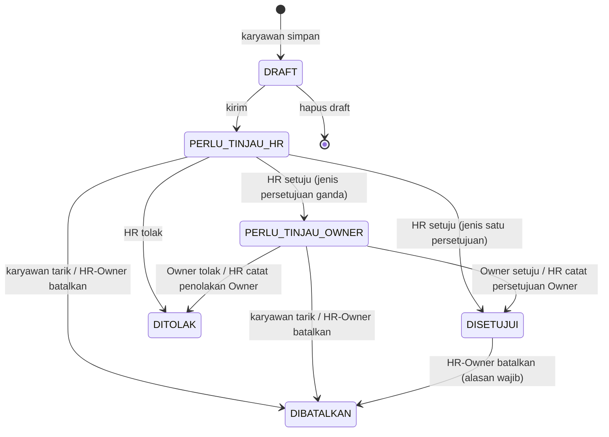

# Desain: Persetujuan Ganda, Surat Izin PDF, dan Area Karyawan Baru

**Tanggal:** 2026-10-24
**Status:** Menunggu persetujuan pengguna
**Dasar:** meeting client 2026-10-23 (K-108, K-109), jawaban pengguna 2026-10-24, dokumen requirement HLX-TKS-ATT-REQ-001 v0.4 Bagian 5.4.

## 1. Maksud

Karyawan login dengan akunnya sendiri (K-108) untuk mengajukan cuti, izin, atau sakit dari HP. Hasilnya berupa surat yang bisa diekspor ke PDF. Untuk jenis tertentu, pengajuan baru sah setelah disetujui HR/Finance lalu Owner (K-109).

Masalah yang mau diatasi: HR dan Owner sering tidak sempat membuka web. Karena itu karyawan harus bisa:

- mengirim surat atau link persetujuan lewat WhatsApp pribadi,
- memperoleh surat bertanda tangan setelah disetujui.

Status di web tetap menjadi sumber kebenaran untuk rekap absensi.

Area karyawan dirombak supaya enak dipakai di HP: beranda baru, alur pengajuan bertahap, dan riwayat status yang jelas.

## 2. Sasaran, bukan sasaran, dan kegagalan

**Sasaran**

1. Status pengajuan: **Draft → Perlu ditinjau HR → Perlu ditinjau Owner → Disetujui**, dengan **Ditolak** dan **Dibatalkan**.
2. Persetujuan ganda hanya untuk jenis izin yang ditandai Owner. Jenis lain cukup satu persetujuan (K-073).
3. Karyawan mengisi data surat sesuai templat jenisnya, menyimpan draft, lalu mengirimnya.
4. PDF surat yang sungguhan (file, bukan dialog cetak) bisa diunduh atau dibagikan kapan saja oleh karyawan, HR, dan Owner.
5. Surat yang disetujui memuat tanda tangan pemberi persetujuan dan QR verifikasi.
6. Tombol "Kirim ke WhatsApp" berisi link langsung ke halaman persetujuan.
7. HR bisa mencatatkan keputusan Owner yang diberikan di luar web (WA, lisan, atau tertulis) dengan cara, waktu, dan bukti.
8. Semua halaman role Karyawan dirombak dengan pendekatan mobile-first.

**Bukan sasaran**

- Integrasi WhatsApp API: tidak ada pesan otomatis dan tidak ada nomor WA tersimpan. Yang dipakai hanya link `wa.me` dan fitur berbagi bawaan HP.
- Kuota cuti, izin per jam, dan dampak ke gaji (tetap Q-013, K-071, K-072).
- Tanda tangan elektronik tersertifikasi (PSrE/BSrE). Tanda tangan di surat hanya gambar spesimen dan tidak bernilai hukum sebagai TTE.
- Perombakan halaman Owner/HR selain bagian izin yang terdampak.
- Notifikasi push ke HP.

**Dianggap gagal walaupun teknisnya jalan**

- Pengajuan bisa berstatus Disetujui tanpa melewati seluruh rantai jenisnya (AC-LV-03).
- Rekap absensi berubah karena draft.
- Dokumen sakit, lampiran, atau alasan rinci terlihat oleh karyawan lain (FR-LV-002).
- PDF "Disetujui" palsu tidak bisa dibedakan dari yang asli.
- Gambar tanda tangan HR/Owner bisa diunduh langsung oleh karyawan di luar surat yang memang sudah mereka setujui.
- Area karyawan terasa seperti panel admin yang dikecilkan di HP.

## 3. Batasan

- Semua aturan di CLAUDE.md berlaku:
  - perubahan schema lewat Flyway (V12 dan seterusnya),
  - audit lewat `AuditService` di transaksi yang sama,
  - hak akses diatur di `SecurityConfig` dan setiap endpoint masuk ke `AccessControlTests`,
  - error dalam bentuk ProblemDetail berbahasa Indonesia,
  - aturan bisnis tidak di-hardcode.
- Penanda persetujuan ganda dan templat surat adalah **data master Jenis Izin** yang diatur Owner (K-070), bukan konstanta di kode.
- Tumpang tindih (K-075) dan efek ke rekap (K-076) tetap berlaku. Status "aktif" diperluas, draft tidak termasuk.
- Brand Takka Steel (K-017) dan tema kaca terang/gelap (K-085) dipertahankan: steel `#104FA6`, gold `#F5CE02`, Poppins + Open Sans, tombol pill, ikon `lucide-react` (sudah dipakai proyek).
- Data yang sudah ada dimigrasi tanpa kehilangan:
  - `MENUNGGU` menjadi `PERLU_TINJAU_HR`,
  - `DISETUJUI` lama tetap, dengan riwayat persetujuan satu tahap dari `decided_by`/`decided_at`.

## 4. Yang diputuskan pengguna

| Hal | Keputusan |
|---|---|
| Jenis yang butuh persetujuan ganda | Diatur per jenis oleh Owner. Menurut meeting: Cuti dan Sakit |
| Urutan | HR/Finance dulu, lalu Owner. Penolakan di tahap mana pun langsung **Ditolak** |
| Status | Draft, Perlu ditinjau HR, Perlu ditinjau Owner, Ditolak, Disetujui, **Dibatalkan tetap ada** |
| Isi surat | Dirancang Claude per jenis (belum ada templat client; diganti bila client mengirim templat, D-05) |
| PDF | Bisa diekspor kapan saja dan dikirim karyawan lewat WA pribadi. Setelah disetujui, surat memuat tanda tangan |
| Keputusan Owner di luar web | HR boleh mencatatkannya atas nama Owner, dengan cara, waktu, dan bukti |
| Cakupan UI | Semua halaman role Karyawan, mobile-first |
| Usulan Claude yang disetujui pengguna ("setuju dengan semua usulan") | Link `wa.me` ke halaman persetujuan, tanda tangan dari gambar spesimen per akun, QR verifikasi di PDF, dan rekap tetap "Tidak hadir + izin menunggu" sampai disetujui di web |

## 5. Alur dan status

**Aturan tiap status**

| Status | Siapa yang bertindak | Efek ke rekap (K-076) | Tumpang tindih (K-075) | Bisa diubah |
|---|---|---|---|---|
| `DRAFT` | Pemilik: ubah, hapus, kirim | Tidak ada | Tidak dicek saat simpan; dicek saat kirim | Semua isian dan lampiran |
| `PERLU_TINJAU_HR` | HR/Finance: setuju/tolak. Owner: setuju/tolak hanya untuk jenis satu persetujuan (K-073). Pemilik: tarik | Penanda `IZIN_MENUNGGU` | Aktif | Lampiran boleh ditambah (K-078) |
| `PERLU_TINJAU_OWNER` | Owner: setuju/tolak. HR: catat keputusan Owner. Pemilik: tarik | Penanda `IZIN_MENUNGGU` | Aktif | Lampiran boleh ditambah |
| `DISETUJUI` | HR/Owner: batalkan dengan alasan | Status `IZIN` / `HADIR_SAAT_IZIN` | Aktif | Tidak |
| `DITOLAK`, `DIBATALKAN` | Tidak ada | Tidak ada | Tidak aktif | Tidak |

**Aturan tambahan**

- **Jenis yang dibekukan saat kirim.** Kebutuhan persetujuan ganda dan templat diambil dari jenis **saat pengajuan dikirim**, lalu disimpan di pengajuan (`requires_owner_approval`, `letter_template`). Owner yang mengubah jenis belakangan tidak mengubah rantai pengajuan yang sedang berjalan.
- **Wajib surat (K-077)** diperiksa saat persetujuan pertama, yaitu persetujuan HR, atau Owner untuk jenis satu persetujuan.
- **Pemisahan tugas (K-079)** berlaku di setiap tahap: akun yang terhubung ke karyawan pemohon tidak bisa menyetujui atau menolak tahap mana pun untuk pengajuan itu, termasuk mencatatkan keputusan Owner.
  - *Keputusan Claude:* bila pemohon adalah satu-satunya HR, Owner boleh mengerjakan tahap HR. Riwayat mencatat bahwa tahap HR dikerjakan Owner, lalu tahap Owner tetap harus dilakukan terpisah.
- **Tarik oleh karyawan** hanya bisa saat `PERLU_TINJAU_*`, dan alasan opsional. Pembatalan oleh HR/Owner wajib beralasan (K-074).
- **Hapus draft** adalah hapus permanen, termasuk lampirannya. Dicatat di audit (`DELETE`) dengan isi sebelumnya.
  - *Keputusan Claude:* draft belum menjadi dokumen resmi, jadi tidak perlu disimpan seperti scan.
- **Persetujuan bersamaan** dijaga `@Version` seperti sekarang. Dua penyetuju yang menekan bersamaan menghasilkan satu tahap.

## 6. Keputusan Owner yang dicatat HR

Fitur ini dipakai saat Owner sudah menjawab lewat WA, lisan, atau tertulis, tetapi tidak membuka web.

- Hanya tersedia di status `PERLU_TINJAU_OWNER`, untuk akun HR/Finance yang bukan pemohon.
- Isian:
  - keputusan: Setuju / Tolak,
  - **cara**: WhatsApp / Lisan / Tertulis,
  - **waktu keputusan Owner** (tanggal + jam, tidak boleh di masa depan dan tidak boleh sebelum tahap HR),
  - **catatan** (wajib),
  - **bukti**: file PDF/JPG/PNG mengikuti aturan lampiran K-078. Bukti wajib untuk WhatsApp dan Tertulis, dan opsional untuk Lisan.
- Riwayat mencatat dua orang: Owner sebagai pemberi keputusan dan HR sebagai pencatat, ditambah waktu pencatatan.
- Owner langsung mendapat notifikasi di aplikasi: *"HR … mencatat persetujuan Anda untuk IZ-000123"*. Bila catatan itu keliru, Owner membatalkan pengajuan dengan alasan.
- **Surat:** tanda tangan Owner **tidak** ditempel bila keputusannya dicatat HR. Di kolom Owner tertulis *"Disetujui melalui WhatsApp pada 24-10-2026 14.05, dicatat oleh [nama HR]"*.
  - *Keputusan Claude:* menempel spesimen tanda tangan untuk tindakan yang tidak dilakukan sendiri sama dengan memalsukan tanda tangan.
- Bukti hanya bisa dibuka HR/Owner (FR-LV-002), dan setiap pembukaannya diaudit seperti lampiran.

## 7. Templat surat per jenis

Jenis Izin mendapat dua kolom baru yang diatur Owner:

- **Butuh persetujuan Owner** (ya/tidak).
- **Templat surat**: `CUTI`, `SAKIT`, `IZIN`, atau `UMUM`.

Data awal: Cuti → `CUTI` + persetujuan ganda, Sakit → `SAKIT` + persetujuan ganda, Izin → `IZIN` + satu persetujuan. Jenis lain → `UMUM` + satu persetujuan. Ini hanya data awal yang bisa diubah Owner.

Isian per templat (*rancangan Claude, belum dari client*):

| Isian | UMUM | IZIN | CUTI | SAKIT |
|---|---|---|---|---|
| Tanggal mulai–selesai (hari penuh, K-071) | wajib | wajib | wajib | wajib |
| Alasan / keperluan | wajib | wajib ("Keperluan") | wajib ("Keperluan cuti") | wajib ("Keluhan / keterangan sakit") |
| No. HP yang bisa dihubungi | opsional | opsional | wajib | opsional |
| Alamat selama cuti | | | wajib | |
| Tugas dilimpahkan kepada | | | opsional (teks bebas) | |
| Nama faskes / dokter | | | | opsional |
| Lampiran | sesuai "wajib surat" jenis | sama | sama | sama (surat dokter) |

Isian tambahan disimpan sebagai kolom bertipe di `leave_requests` yang boleh kosong. Kewajibannya divalidasi di server menurut templat yang dibekukan, **saat dikirim**. Draft boleh belum lengkap.

## 8. Surat PDF

**Pembuatan di server.** Endpoint `GET …/{id}/letter.pdf` menghasilkan file PDF A4 yang bisa diunduh, dibagikan, dan dicetak.

- *Keputusan Claude:* pembuatan di server **menggantikan sebagian K-082** (cetak lewat browser), karena:
  - tanda tangan HR/Owner tidak boleh dikirim mentah ke browser karyawan,
  - QR dan nomor surat harus konsisten,
  - fitur "Simpan sebagai PDF" di HP (terutama iOS) tidak bisa diandalkan untuk dikirim lewat WA.
- Library yang diusulkan: **OpenPDF** (LGPL/MPL) untuk PDF dan **ZXing** (Apache-2.0) untuk QR, keduanya dependensi Maven baru.
- Font Poppins dan Open Sans di-embed dari file yang sudah di-self-host.

**Isi surat**

- Kop TAKKA STEEL dan cabang, nomor `IZ-000123`, dan judul sesuai templat (Surat Permohonan Cuti / Izin / Keterangan Sakit).
- Identitas pemohon, isian templat, dan daftar nama lampiran. Isi lampiran tidak ikut dalam surat.
- Kotak tanda tangan:
  - **Pemohon**: spesimen tanda tangan karyawan bila ada, atau nama saja.
  - **HR/Finance** dan **Owner** untuk jenis persetujuan ganda, atau satu kotak **Disetujui oleh** untuk jenis satu persetujuan. Setiap kotak berisi spesimen, nama, dan tanggal, dan baru terisi setelah tahapnya disetujui di web.
- **Cap status** diagonal untuk surat yang belum final: `DRAFT`, `MENUNGGU PERSETUJUAN`, `DITOLAK`, `DIBATALKAN`. Surat Disetujui tidak bercap.
- **QR verifikasi** dan teks link: `https://<server>/verifikasi/<token>`, dengan token acak 128-bit per pengajuan yang dibuat saat dikirim.
- Kaki surat: dibuat dari sistem pada [waktu], beserta jejak singkat siapa menyetujui kapan.

**Halaman verifikasi publik** `/verifikasi/:token`, tanpa login.

- Menampilkan nomor surat, nama karyawan, cabang, jenis, rentang tanggal, status terkini, dan siapa menyetujui kapan.
- Alasan, isian rinci, dan lampiran tidak ditampilkan.
- Token salah menghasilkan "Surat tidak ditemukan".
- *Keputusan Claude:* halaman ini publik karena orang yang menerima PDF lewat WA belum tentu punya akun. Data yang tampil dibatasi seperti daftar rekan kerja (K-083). Endpoint diberi batas laju (rate limit).

**Akses PDF**

- Pemilik (endpoint `/api/me`).
- Owner/HR (endpoint manajer).
- Karyawan lain mendapat 404.
- Setiap unduhan oleh Owner/HR diaudit (`VIEW`), seperti lampiran.

## 9. Spesimen tanda tangan

- Setiap akun (Karyawan, HR/Finance, Owner) boleh menyimpan **satu spesimen tanda tangan** di halaman Profil.
- Cara mengisinya: menggambar di kanvas (jari/stylus, pointer events) atau mengunggah PNG/JPG.
  - Server menormalkannya menjadi PNG transparan maksimal 600×200.
  - File maksimal 1 MB, dan jenisnya dicek dari isi file (K-078).
- Disimpan di volume yang sama dengan lampiran. Spesimen bisa diganti atau dihapus, dan setiap perubahan diaudit tanpa isi gambar.
- **Pembacaan:**
  - Pemilik bisa melihat spesimennya sendiri.
  - Tidak ada endpoint untuk melihat spesimen akun lain.
  - Spesimen orang lain hanya dipakai di dalam PDF, dan hanya untuk tahap yang benar-benar dia setujui sendiri.
- **Pembekuan:** saat sebuah tahap disetujui, spesimen penyetuju **disalin** ke rekaman tahap itu. Mengganti spesimen belakangan tidak mengubah surat lama.
- Tanpa spesimen, kotak tanda tangan berisi nama dan tulisan *"disetujui secara elektronik"*.

## 10. Kirim ke WhatsApp

Di detail pengajuan (karyawan) ada dua tombol, aktif saat status `PERLU_TINJAU_*`:

1. **Kirim ke WhatsApp**: membuka `https://wa.me/?text=…` tanpa nomor, lalu karyawan memilih kontak HR atau Owner. Contoh teks:
   *"Permohonan Cuti IZ-000123 a.n. Budi Santoso, 3–5 Nov 2026. Mohon ditinjau: https://<server>/izin/123"*
   Link mengarah ke halaman persetujuan manajer; tamu diarahkan ke login lalu kembali ke link itu.
2. **Bagikan PDF**: memakai Web Share API dengan file bila didukung, yaitu Android Chrome dan iOS Safari (lembar berbagi berisi WhatsApp). Bila tidak didukung, PDF diunduh.

Alamat server untuk link diambil dari konfigurasi `app.public-base-url`. Bila kosong, dipakai origin halaman.

## 11. Area karyawan baru

**Bacaan desain:** aplikasi layanan mandiri internal untuk karyawan pabrik baja yang memakai HP Android kelas menengah. Pendekatannya perombakan yang mempertahankan brand. Kepadatan rendah, tipografi dan jarak yang tenang, gerak hanya untuk umpan balik.

- Taste-skill dipakai hanya untuk aturan produk: semua kondisi tampilan, mode gelap, tanpa em-dash, satu keluarga ikon, dan tidak ada kartu yang tidak perlu.
- ui-ux-pro-max dipakai untuk aturan UX: target sentuh minimal 44px, kontras 4.5:1, label di atas isian, `inputmode`/`type` yang sesuai, skeleton saat memuat, umpan balik setelah kirim, dan `prefers-reduced-motion`.
- Palet dan font usulan ui-ux-pro-max (navy + Atkinson) **ditolak** karena bentrok dengan K-017.

**Navigasi karyawan**

- HP: **navigasi bawah** berisi 4 item: Beranda, Izin, Rekan, Profil.
- Desktop: sidebar seperti sekarang.
- Beranda menjadi halaman awal role Karyawan, menggantikan `/profil` di `homePathFor`.

| Halaman | Isi |
|---|---|
| **Beranda** `/beranda` (baru) | Sapaan dan tanggal; kartu **Hari ini** (jam masuk/pulang dan status, dari data rekan kerja milik sendiri); **Pengajuan berjalan** (maks. 3, dengan langkah status ringkas); tombol utama **Ajukan izin**; ringkasan bulan ini (hadir, izin, tidak hadir) dari data yang sudah bisa dilihat karyawan (K-083). Tidak ada data gaji. |
| **Izin** `/izin-saya` | Tab status (Berjalan / Draft / Selesai); setiap pengajuan tampil sebagai baris dengan jenis, tanggal, dan lencana status; keadaan kosong dengan ajakan mengajukan. |
| **Ajukan** `/izin-saya/baru` dan `/izin-saya/:id/ubah` | Alur 4 langkah dengan indikator langkah: **1. Jenis** (pilihan besar per jenis aktif, dengan keterangan "butuh persetujuan HR & Owner" / "wajib surat") → **2. Tanggal & isian** (sesuai templat; jumlah hari dihitung langsung) → **3. Lampiran & tanda tangan** (unggah/foto dari kamera; tanda tangan diambil dari profil, atau digambar di sini dan disimpan ke profil) → **4. Pratinjau** (PDF draft disematkan atau ringkasan, plus **Simpan draft** dan **Kirim**). Draft tersimpan otomatis saat berpindah langkah. |
| **Detail** `/izin-saya/:id` | Lencana status besar; **garis waktu** Draft → Ditinjau HR → Ditinjau Owner → Disetujui, berisi siapa, kapan, dan cara (web/WA/lisan/tertulis); tombol sesuai status: Ubah/Hapus/Kirim (draft), Kirim ke WhatsApp/Bagikan PDF/Tarik (menunggu), Unduh PDF (selalu); lampiran. |
| **Rekan** `/rekan-kerja` | Isi dan pembatasan data tetap (K-083/K-084). Hanya tata letak di HP yang diperbaiki: baris berupa kartu ringkas dan pencarian nama. |
| **Profil** `/profil` | Data diri yang sudah ada, **tanda tangan saya** (gambar/unggah/hapus), dan ganti password. |

**Detail visual**

- Status memakai token semantik yang sudah ada:
  - Draft: netral
  - Perlu ditinjau HR/Owner: `warning`
  - Disetujui: `success`
  - Ditolak: `danger`
  - Dibatalkan: netral dicoret
- Status selalu tampil dengan teks dan ikon, tidak mengandalkan warna saja.
- Radius mengikuti design system: tombol pill, kartu radius design system. Kaca hanya pada panel, tidak bertumpuk.
- Gerak: transisi langkah 200 ms (geser + pudar) dan tombol `active:scale-[0.98]`. Tanpa animasi berulang, dan statis saat `prefers-reduced-motion`.
- Setiap halaman punya keadaan memuat (skeleton sesuai bentuknya), kosong, dan gagal (`ErrorAlert`).

**Halaman manajer yang ikut disesuaikan:**

- daftar Izin: filter status baru, kolom tahap,
- detail: garis waktu yang sama, tombol tahap, dialog "Catat keputusan Owner", unduh PDF,
- Jenis Izin: dua kolom baru,
- notifikasi: ke Owner saat masuk tahap Owner atau saat keputusannya dicatat HR.

## 12. Perubahan data dan API (arah, rincian untuk rencana)

**Migration V12**

- Status di `leave_requests`:
  - status baru `DRAFT`, `PERLU_TINJAU_HR`, `PERLU_TINJAU_OWNER`,
  - `MENUNGGU` dimigrasi ke `PERLU_TINJAU_HR`,
  - CHECK dan exclusion constraint diperbarui: aktif = `PERLU_TINJAU_HR`, `PERLU_TINJAU_OWNER`, `DISETUJUI`.
- Kolom baru di `leave_requests`:
  - `requires_owner_approval`, `letter_template`,
  - `contact_phone`, `leave_address`, `delegate_to`, `health_facility`,
  - `submitted_at` boleh kosong untuk draft (`created_at` baru),
  - `verification_token` unik.
- `leave_types`: `requires_owner_approval`, `letter_template`, dengan data awal seperti §7.
- Tabel baru `leave_approvals`: pengajuan, tahap `HR`/`OWNER`, keputusan, pemberi keputusan, waktu keputusan, cara `WEB`/`WHATSAPP`/`LISAN`/`TERTULIS`, pencatat, waktu pencatatan, catatan, lampiran bukti, salinan spesimen. Riwayat lama dibuat dari `decided_*`.
- Tabel baru `user_signatures`: akun, path file, hash, waktu.

**API (bentuk awal)**

- `/api/me/leave-requests`: `POST` membuat draft; `PUT /{id}` mengubah draft; `DELETE /{id}` menghapus draft; `POST /{id}/submit`; `POST /{id}/cancel` (menarik); `GET /{id}/letter.pdf`.
- `/api/leave-requests`: `POST /{id}/approve` dan `/reject` sadar tahap; `POST /{id}/owner-decision` (multipart, HR); `GET /{id}/letter.pdf`.
- `/api/me/signature`: `GET`/`PUT`/`DELETE` untuk semua role.
- `/api/public/letters/{token}`: verifikasi tanpa login.
- Semua endpoint baru masuk ke `AccessControlTests`.

## 13. Pengujian

- **TC-19** (aturan-bisnis §13) dan AC-LV-01 sampai AC-LV-06 dari dokumen requirement menjadi test otomatis.
- Test tambahan:
  - setiap transisi status, valid maupun tidak valid,
  - draft tidak memengaruhi rekap dan tumpang tindih,
  - jenis dibekukan saat kirim,
  - K-079 di setiap tahap,
  - pencatatan keputusan Owner beserta bukti wajibnya,
  - migrasi data `MENUNGGU`,
  - PDF: dibuat, berisi nomor dan status, dan spesimen hanya untuk tahap yang disetujui,
  - halaman verifikasi tidak membocorkan alasan atau lampiran,
  - spesimen orang lain tidak bisa dibaca.
- Frontend: test untuk alur 4 langkah, garis waktu, tombol per status, navigasi bawah, dan tanda tangan kanvas.
- Diuji manual di HP (375 px) dalam mode terang dan gelap sebelum dinyatakan selesai.

## 14. Keputusan kecil Claude (hasil pemeriksaan pembangun)

- **Lebih dari satu Owner:** tahap Owner boleh dikerjakan akun Owner mana pun.
- **Pengajuan yang dicatat HR/Owner atas nama karyawan (K-073)** langsung berstatus `PERLU_TINJAU_HR` tanpa draft. Validasi templat tetap berlaku. Pencatat boleh menyetujui tahap HR dalam tindakan terpisah, kecuali jika ia sendiri pemohonnya (K-079).
- **Halaman cetak lama** `LeaveLetterPage` (`/izin/:id/surat`, `/izin-saya/:id/surat`) dihapus. Route lama diarahkan ke detail pengajuan, dan semua tombol cetak diganti "Unduh PDF".
- **Batas laju verifikasi publik** dibuat di dalam aplikasi: hitungan per IP di memori (misalnya 30 permintaan per menit), dengan nilai di `application.properties` sebagai parameter teknis.
- **Data Beranda** memakai endpoint rekan kerja yang sudah ada untuk diri sendiri. Endpoint baru hanya dibuat bila ringkasan bulanan tidak bisa diambil dari endpoint itu, dan endpoint baru itu tetap tanpa data sensitif.
- **Karyawan tidak mendapat notifikasi langsung.** Perubahan status terlihat di Beranda dan Izin, seperti K-081 sekarang.

## 15. Diserahkan ke pembuat rencana

- Pembagian tugas dan urutan. Saran: backend status + persetujuan → PDF + tanda tangan + verifikasi → UI karyawan → penyesuaian UI manajer.
- Nama kelas dan DTO, letak komponen, dan bentuk persis respons API.
- Pilihan library kanvas tanda tangan (implementasi sendiri dengan pointer events, atau paket kecil yang sudah dipelihara).
- Tata letak rinci PDF dalam batas §8.

## 16. Dokumen yang diperbarui setelah implementasi

- `keputusan.md`: rincian K-109, sebagian K-082 diganti oleh PDF server, spesimen tanda tangan, verifikasi publik, dan pencatatan keputusan Owner.
- `aturan-bisnis.md` §4.8.
- `alur.md`: diagram izin.
- `rencana-fase-4.md` (catatan).
- `design-system.md`: navigasi bawah, garis waktu status, langkah form.
