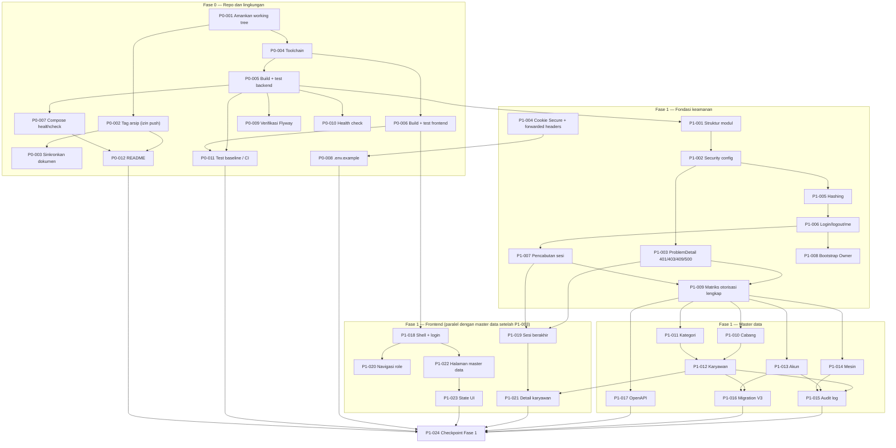

# Technical Task Breakdown — Fase 0 dan Fase 1

**Status dokumen:** Sebagian disetujui (B-03, B-04). B-01 dan B-02 menunggu konfirmasi.
**Tanggal audit:** 2026-10-11

## Progres (2026-10-11)

| Task | Status | Bukti |
|---|---|---|
| P0-004 Toolchain | Selesai | JDK 21.0.8 (`C:\Program Files\Java\jdk-21`), Maven 3.9.16 (wrapper), Node 24.18.0, Docker 29.7.2 |
| P0-005 Baseline backend | Selesai | Sebelum perubahan: 39 test, 0 gagal. Setelah perubahan: 86 test, 0 gagal (`./mvnw -B clean verify`, JDK 21) |
| P0-006 Baseline frontend | Selesai | Sebelum: lint 3 warning, build sukses, test 15 lulus (run pertama cold start: 3 error timeout worker). Setelah: 22 test lulus, lint 3 warning yang sama, build sukses |
| P0-007 Compose healthcheck | Selesai | Diverifikasi dengan project terpisah `bas-verifikasi`: db → backend `healthy` → frontend; health lewat nginx `UP` |
| P0-008 `.env.example` | Selesai | `SESSION_COOKIE_SECURE`, `OPENAPI_ENABLED` |
| P1-003 ProblemDetail 401/403/409/400 | Selesai | `AccessControlTests` |
| P1-004 Cookie Secure + forwarded headers | Selesai | `SessionCookieHttpTests` (server HTTP sungguhan) |
| P1-007 Pencabutan sesi (K-044) | Selesai | `SessionRevocationTests` (sesi JDBC sungguhan) |
| P1-009 Matriks otorisasi | Selesai | `AccessControlTests` 40, `UserAccountTests` 12, `LastOwnerRuleTests` 2 |
| P1-017 OpenAPI (K-045) | Selesai | springdoc 3.1.1, `OpenApiAccessTests` |
| P1-019 Sesi berakhir di frontend | Selesai | `App.test.tsx` |
| P1-021 Detail karyawan | Selesai | `EmployeeDetailPage.test.tsx` |
| P0-002 Tag arsip (B-01) | Diverifikasi, belum dibuat | Lihat bagian I.1 |
| P1-016 Migration V3 (B-02) | Belum dibuat | Detail review di bagian E.3 |

**Bug yang ditemukan dan diperbaiki saat pengerjaan:**

1. `PUT /api/users/{id}` yang mengubah role menjadi `EMPLOYEE` selalu gagal 500 (auto-flush Hibernate sebelum `employee_id` diisi melanggar CHECK `user_accounts_employee_required`).
2. Sesi tersimpan dengan timeout 30 menit, bukan 8 jam (K-014): `server.servlet.session.timeout` tidak dipakai Spring Session JDBC di Spring Boot 4. Diperbaiki dengan `spring.session.timeout=8h`.
**Cakupan:** Fase 0 (repo dan lingkungan) dan Fase 1 (akun, role, master data) dari [rencana-pengerjaan.md](rencana-pengerjaan.md).

> **Hal terpenting dari audit:** Fase 0 dan Fase 1 **sudah diimplementasikan** di `main` (lihat [rencana-pengerjaan.md](rencana-pengerjaan.md): "Fase 0 dan Fase 1 selesai"). Karena itu dokumen ini tidak merencanakan pembangunan dari nol. Isinya: (1) task **verifikasi** untuk bagian yang sudah ada, dan (2) task **penutupan gap** yang ditemukan saat audit. Setiap task diberi status:
>
> - **ADA**: sudah ada di kode, cukup diverifikasi.
> - **GAP**: belum ada atau belum memenuhi dokumen. Perlu dikerjakan.
> - **USULAN**: perubahan schema, kontrak API, dependency, atau konfigurasi. Menurut `CLAUDE.md`, ini wajib disetujui dulu.

---

## A. Audit Repository Saat Ini

### A.1 Fakta yang ditemukan

**Git**

| Item | Temuan |
|---|---|
| Branch | `main`, sinkron dengan `origin/main`, working tree bersih |
| Commit terakhir | `e915fe4` (dokumentasi arsitektur). Total 19 commit |
| Tag | **Tidak ada satu pun tag**, baik lokal (`git tag -l`) maupun remote (`git ls-remote --tags origin`) |
| Eksperimen NestJS | Ada di commit `26bed0a` ("setup awal project fingerprint manajemen karyawan"): folder `backend/` berisi 59 file, termasuk 31 file `backend/dist/` hasil build dan `backend/.env.example` versi lama |
| Penghapusan NestJS | Dilakukan di commit `61566a5` ("Fase 0: dokumentasi proyek dan kerangka Spring Boot + React") |
| Riwayat | `26bed0a` masih bisa dijangkau dari `main`, jadi isi eksperimen lama tidak hilang selama riwayat tidak ditulis ulang |

**Struktur repo (file yang di-track, 140 file)**

```text
.
├── .env.example, .gitignore, CLAUDE.md, README.md
├── docker-compose.yml           # db (postgres:17-alpine), backend, frontend
├── start-dev.bat, stop-dev.bat  # launcher Windows
├── docs/                        # 10 dokumen
├── backend/                     # Spring Boot 4.1.1, Java 21, Maven wrapper
│   ├── Dockerfile               # build multi-stage, test dilewati (-DskipTests)
│   └── src/
│       ├── main/java/com/biometricattendance/
│       │   ├── BackendApplication.java
│       │   ├── config/          # SecurityConfig, WebConfig
│       │   ├── common/          # ApiException, CurrentUser, GlobalExceptionHandler, PageResponse
│       │   ├── auth/            # AuthController, AuthDtos, AuthService, PasswordChangeGuard
│       │   ├── account/         # UserAccount*, Role, OwnerBootstrap, MyProfileController
│       │   ├── branch/ category/ employee/ device/   # entity, repo, DTO, service, controller
│       │   └── audit/           # AuditLog, AuditService, AuditLogController
│       ├── main/resources/
│       │   ├── application.properties
│       │   └── db/migration/V1__akun_dan_master_data.sql, V2__sesi_login.sql
│       └── test/java/...        # 9 file test (lihat A.1 "Test")
└── frontend/                    # React 19 + Vite 8 + TS 6, Tailwind 4, shadcn (radix-ui)
    ├── Dockerfile, nginx.conf   # nginx meneruskan /api/ dan /actuator/health ke backend
    └── src/
        ├── App.tsx, navigation.ts, main.tsx, index.css
        ├── auth/AuthContext.tsx
        ├── components/          # AppLayout, CrudPage, FormDialog, PageHeader, feedback, Brand, ui/ (10 komponen shadcn)
        ├── lib/                 # api.ts (CSRF), types.ts, format.ts, form.ts, ui.ts, utils.ts
        ├── pages/               # Login, ChangePassword, Dashboard, Employees, Branches, Categories, Devices, Users, AuditLog, Profile
        └── test/                # setup.ts, fetchMock.ts
```

**Backend yang sudah berjalan (berdasarkan isi kode, bukan hasil eksekusi)**

| Area | Implementasi |
|---|---|
| Dependency | actuator, data-jpa, flyway (+ flyway-database-postgresql), security, session-jdbc, validation, webmvc, postgresql. Test: starter test per modul, Testcontainers PostgreSQL |
| Security | `SecurityConfig`: aturan per URL terpusat, `csrf.spa()`, 401 untuk anonim, logout `POST /api/auth/logout` → 204, `anyRequest().denyAll()` |
| Password | `PasswordEncoderFactories.createDelegatingPasswordEncoder()` (bcrypt bawaan) |
| Sesi | Spring Session JDBC, timeout `8h`, cookie `http-only`, `same-site=lax`. Tabel dibuat via Flyway V2 (`initialize-schema=never`) |
| Login | Username di-`trim().toLowerCase(Locale.ROOT)` saat login dan saat simpan; `changeSessionId()` setelah login |
| Ganti password wajib | `PasswordChangeGuard` (interceptor) menolak semua `/api/**` kecuali `/api/auth/**` jika atribut sesi `MUST_CHANGE_PASSWORD` bernilai true. Atribut diisi saat login |
| Owner pertama | `OwnerBootstrap` membuat Owner dari `OWNER_USERNAME`/`OWNER_INITIAL_PASSWORD` hanya jika belum ada Owner sama sekali; `must_change_password=true`; dicatat ke audit dengan aktor `system` |
| Aturan akun | `UserAccountService`: HR/Finance hanya mengelola role `EMPLOYEE`; tidak bisa menonaktifkan/mengubah role akun sendiri; minimal satu Owner aktif; reset password memaksa ganti password |
| Master data | Cabang, kategori, karyawan, mesin: list/create/update, duplikat → 409, tidak ada endpoint hapus (nonaktif lewat `active`) |
| Audit | `AuditService.record` dengan `Propagation.MANDATORY` (wajib di dalam transaksi), menyimpan before/after dalam JSON. Baca audit hanya Owner |
| Error | `GlobalExceptionHandler` → ProblemDetail, pesan Bahasa Indonesia, error validasi per field di properti `errors` |
| Health | `/actuator/health` publik; hanya endpoint `health` yang diekspos |

**Database (Flyway)**

| Migration | Isi |
|---|---|
| `V1__akun_dan_master_data.sql` | `branches`, `employee_categories` (+ seed `KANTOR`, `SUPIR_KENEK`), `employees`, `user_accounts`, `devices`, `audit_logs` |
| `V2__sesi_login.sql` | `SPRING_SESSION`, `SPRING_SESSION_ATTRIBUTES` (disalin dari schema spring-session-jdbc 4.1.1) |

`spring.jpa.hibernate.ddl-auto=validate`, `open-in-view=false`. (`hibernate.jdbc.time_zone=UTC` sempat dipakai lalu dihapus di Fase 3 karena menggeser kolom jam tanpa zona; lihat K-069.)

**Test yang tersedia**

| File | Cakupan |
|---|---|
| `BackendApplicationTests` | Context load (implisit: Flyway V1–V2 berjalan di PostgreSQL Testcontainers, JPA `validate` lulus) |
| `HealthEndpointTests` | Health publik dan `UP`; endpoint tak dikenal → 401 |
| `auth/AuthFlowTests` | Owner bootstrap, password salah, login tanpa CSRF, ganti password wajib memblokir API lain, password lama salah, logout, akun nonaktif |
| `account/UserAccountTests` | HR membuat akun karyawan tapi tidak Owner/HR, Owner membuat HR, akun karyawan wajib terhubung satu karyawan, username case-insensitive dan unik, HR hanya melihat akun karyawan, Owner tidak bisa menonaktifkan diri, reset password → 204 |
| `masterdata/MasterDataTests` | Audit create/update cabang, kode cabang duplikat, zona waktu tidak dikenal, error per field, karyawan + duplikat nomor, tanggal keluar < tanggal masuk, serial mesin unik |
| `security/AccessControlTests` | GET master data per role, karyawan tidak bisa POST master data, POST tanpa CSRF, audit log hanya Owner |
| Frontend | `App.test.tsx`, `navigation.test.ts`, `lib/api.test.ts`, `lib/format.test.ts`, `pages/LoginPage.test.tsx` (Vitest + Testing Library + jsdom) |

**Frontend yang sudah berjalan (berdasarkan isi kode)**

- Routing dengan `RequireAuth` (redirect ke `/login` atau `/ganti-password`) dan `RequireRole`.
- Menu per role (`navigation.ts`), sidebar/bottom navigation sesuai design system.
- `api.ts` mengambil token CSRF dari cookie `XSRF-TOKEN` (fallback `GET /api/auth/csrf`), melempar `ApiError` dari ProblemDetail.
- Halaman master data memakai `CrudPage` + `FormDialog` (list, tambah, ubah dalam dialog).

**Lingkungan lokal mesin audit**

| Tool | Versi terdeteksi | Kebutuhan proyek |
|---|---|---|
| Java | 25.0.4.1 | Java 21 (`<java.version>21</java.version>`) |
| Node | v24.18.0 | Node 24 (README, Dockerfile `node:24-alpine`) |
| Docker | 29.7.2 | Dibutuhkan untuk Compose dan Testcontainers |

`frontend/node_modules` belum terpasang. `backend/target/` ada (di-ignore git).

**Test belum dijalankan pada audit ini.** Status lulus/gagal test saat ini **tidak diketahui**. Test tidak dijalankan karena tugas ini dibatasi pada analisis: backend test menjalankan migration di container, dan frontend test butuh `npm ci`.

### A.2 Komponen yang belum tersedia

| Komponen | Acuan dokumen | Catatan |
|---|---|---|
| Git tag arsip `archive/zkteco-adms-experiment` | K-009, `README.md`, `CLAUDE.md` | Dokumen menyebut tag sudah ada, padahal tidak ada |
| OpenAPI / springdoc | K-001, `arsitektur.md` §3, NFR-MAINT-003 (P1) | Dependency belum ada di `pom.xml` |
| Pencabutan sesi aktif saat akun dinonaktifkan, role diubah, atau password di-reset | K-015, K-016, NFR-SEC-002 | Lihat A.4 risiko R-01 |
| Halaman detail karyawan | Permintaan tugas ini | Saat ini hanya daftar + dialog tambah/ubah |
| Penanganan sesi kedaluwarsa di frontend | `arsitektur.md` §12 | 401 di tengah sesi hanya tampil sebagai error, tidak diarahkan ke login |
| Pesan 403 dari Spring Security dalam Bahasa Indonesia | `CLAUDE.md` (ProblemDetail, pesan Indonesia) | `accessDeniedHandler` tidak diatur, body 403 kosong |
| Konfigurasi cookie `Secure` dan forwarded headers untuk produksi | `arsitektur.md` §10.1, NFR-SEC-006 | Belum ada; relevan saat di belakang nginx/TLS |
| Healthcheck container backend | Fase 0 | `docker-compose.yml` hanya punya healthcheck `db`; `frontend` hanya `depends_on: backend` tanpa kondisi |
| CI (build + test otomatis) | Tidak diwajibkan dokumen | Rekomendasi, butuh keputusan |
| Relasi karyawan ↔ ID biometrik ↔ mesin | EMP-008, BIO-001/002 (P0) | Diblokir Q-018/Q-019; bukan cakupan Fase 1 di `rencana-pengerjaan.md` |
| Komponen gaji (gaji pokok, upah harian) pada karyawan | EMP-007, K-032, K-033 | Harus bertanggal efektif; masuk Fase 2 (Pengaturan Aturan) |
| Periode payroll per kategori (mingguan/bulanan) | K-031 | `employee_categories` belum punya kolom periode; masuk Fase 2/5 |

### A.3 Konfigurasi yang perlu diubah (rekomendasi, belum dilakukan)

| File | Rekomendasi | Status |
|---|---|---|
| `docker-compose.yml` | Healthcheck backend ke `/actuator/health`; `frontend.depends_on.backend.condition: service_healthy` | USULAN |
| `application.properties` | `server.servlet.session.cookie.secure=${SESSION_COOKIE_SECURE:false}`, `server.forward-headers-strategy=native` | USULAN |
| `.env.example` | Tambah `SESSION_COOKIE_SECURE` (contoh nilai `false` untuk lokal) | USULAN |
| `backend/pom.xml` | Tambah springdoc (versi yang kompatibel dengan Spring Boot 4.1 harus diverifikasi dulu) | USULAN |
| `README.md`, `CLAUDE.md` | Sesuaikan pernyataan tentang tag arsip (sesudah P0-002, atau koreksi jika tag tidak dibuat) | USULAN |
| `docs/rencana-pengerjaan.md` | Status "Fase 0 dan Fase 1 selesai" perlu catatan gap dari dokumen ini | USULAN |

### A.4 Risiko dan potensi konflik

| ID | Risiko | Dampak |
|---|---|---|
| R-01 | **Sesi lama tetap berlaku.** `PasswordChangeGuard` membaca atribut sesi yang hanya diisi saat login. Jika HR/Owner me-reset password atau menonaktifkan akun, sesi yang sedang aktif milik akun itu tetap bisa memakai API sampai sesi berakhir (maks. 8 jam). Role yang diubah juga tidak berlaku sampai login ulang | Bertentangan dengan K-015 ("wajib mengganti password sebelum dapat menggunakan API lain") dan AUTH-008/010. **Prioritas tinggi** |
| R-02 | Migration V1 dan V2 kemungkinan sudah diterapkan di database lokal anggota tim | Jangan mengedit V1/V2. Semua perubahan schema lewat V3 dan seterusnya |
| R-03 | Keunikan `employee_number` dan `serial_number` diperiksa case-insensitive di aplikasi, tapi constraint DB case-sensitive dan nilainya tidak dinormalisasi | Dua request bersamaan bisa lolos dengan beda huruf besar/kecil; jika terjadi, DB tidak menolak |
| R-04 | Pelanggaran unique constraint di DB (race) tidak ditangani `GlobalExceptionHandler` | Pengguna mendapat 500, bukan 409 |
| R-05 | Login ke akun nonaktif mengembalikan "Akun dinonaktifkan". Spring memeriksa status akun sebelum password | Pihak luar bisa mengetahui username yang ada dan statusnya tanpa tahu password |
| R-06 | Tidak ada pembatasan percobaan login (rate limit/lockout) | Brute force password. Kebijakannya belum ada di dokumen |
| R-07 | Java lokal 25, proyek menargetkan 21 | Biasanya aman (`release 21`), tetapi API Java > 21 bisa terpakai tanpa sengaja di IDE. Docker build memakai Temurin 21, jadi CI/Docker tetap acuan |
| R-08 | `backend/Dockerfile` membangun dengan `-DskipTests` | Image bisa terbangun dari kode yang test-nya gagal jika tidak ada langkah test terpisah |
| R-09 | `backend/.env.example` di commit `26bed0a` berisi `DATABASE_URL` dengan pola `user:password@` | Perlu dicek apakah itu placeholder. Commit ini sudah ada di `origin/main`, jadi membuat tag tidak menambah paparan |
| R-10 | `arsitektur.md` §7 menyarankan sub-paket `controller/application/domain/...`, sedangkan kode memakai paket datar per modul (sesuai `CLAUDE.md`) | Bukan konflik nyata (§7 menyebut "panduan awal"), tetapi perlu dicatat agar tidak ada refactor yang tidak perlu |
| R-11 | Karyawan bisa dinonaktifkan tanpa menonaktifkan akun web-nya, dan bisa ditempatkan di cabang/kategori nonaktif | `alur.md` §13 meminta akun dinonaktifkan "sesuai prosedur", tetapi prosedurnya belum diputuskan |

### A.5 File lama: pertahankan, arsipkan, hapus

| File/folder | Rekomendasi | Alasan |
|---|---|---|
| Eksperimen NestJS (`26bed0a:backend/`) | **Arsipkan** dengan tag `archive/zkteco-adms-experiment` pada `26bed0a` (K-009). Tidak ada folder yang perlu dihapus lagi | Sudah dihapus dari working tree di `61566a5`; tag hanya memberi nama yang stabil |
| `start-dev.bat`, `stop-dev.bat` | **Pertahankan** | Dipakai dan didokumentasikan di README. Catatan: `stop-dev.bat` menjalankan `docker compose down` (volume tidak dihapus) dan mematikan proses apa pun yang mendengar port 5173/8080 |
| `backend/target/` (lokal, di-ignore) | Biarkan; boleh dihapus kapan saja oleh pemilik mesin | Artefak build |
| Semua file lain | **Pertahankan** | Bagian dari implementasi Fase 0–1 aktif |

Tidak ada file yang dihapus, dipindahkan, atau diubah pada tahap ini.

---

## B. Fase 0 — Repository dan Lingkungan

Format setiap task: Tujuan · Konteks · File · Dependency · Langkah · Acceptance criteria · Verifikasi · Risiko.

### P0-001 — Pengamanan working tree dan secret · ADA (verifikasi)

- **Tujuan:** memastikan repo bersih dan tidak ada credential yang ter-commit sebelum pekerjaan dimulai.
- **Konteks:** K-011 (langsung di `main`), NFR-SEC-004.
- **File:** tidak ada perubahan.
- **Dependency:** —
- **Langkah:** jalankan perintah verifikasi; jika ada temuan, hentikan dan laporkan.
- **AC:** working tree bersih; `.env` tidak di-track; tidak ada string password nyata di file yang di-track.
- **Verifikasi:**
  ```bash
  git status --short
  git ls-files | grep -E '(^|/)\.env$'          # harus kosong
  git grep -nIiE 'password\s*=' -- ':!*.md' ':!*.example'
  ```
- **Risiko:** hasil `git grep` perlu dibaca manual; nilai di test (mis. `password-awal`) adalah data uji, bukan credential.

### P0-002 — Tag arsip eksperimen NestJS · GAP · butuh izin

- **Tujuan:** memenuhi K-009 dan membuat pernyataan di README/CLAUDE.md menjadi benar.
- **Konteks:** tag tidak ada di lokal maupun remote; commit `26bed0a` berisi eksperimen.
- **File:** tidak ada file; membuat ref git.
- **Dependency:** P0-001.
- **Langkah:**
  1. Periksa `26bed0a:backend/.env.example` dan pastikan `DATABASE_URL` hanya placeholder (R-09).
  2. `git tag -a archive/zkteco-adms-experiment 26bed0a -m "Arsip eksperimen backend NestJS (K-009)"`.
  3. Push tag **hanya setelah izin pengguna**: `git push origin archive/zkteco-adms-experiment`.
- **AC:** tag menunjuk ke `26bed0a`; `backend/package.json` dapat dibaca dari tag.
- **Verifikasi:**
  ```bash
  git rev-parse archive/zkteco-adms-experiment^{commit}     # = 26bed0a...
  git show archive/zkteco-adms-experiment:backend/package.json | head
  git ls-remote --tags origin | grep zkteco                # setelah push
  ```
- **Risiko:** push tag adalah tindakan ke luar (remote) dan wajib izin.

### P0-003 — Sinkronkan dokumen dengan kondisi repo · GAP · USULAN

- **Tujuan:** README, CLAUDE.md, dan rencana-pengerjaan sesuai fakta.
- **File:** `README.md`, `CLAUDE.md`, `docs/rencana-pengerjaan.md`, `docs/README.md` (indeks belum mencantumkan `PRD.md` dan dokumen ini).
- **Dependency:** P0-002 (isi teks bergantung pada apakah tag dibuat).
- **Langkah:** perbarui kalimat tentang tag; tambahkan catatan "gap Fase 0–1, lihat technical-task-breakdown.md" di rencana; tambahkan `PRD.md` dan dokumen ini ke indeks.
- **AC:** tidak ada pernyataan di dokumen yang bertentangan dengan `git tag -l`.
- **Verifikasi:** `git tag -l` dibandingkan dengan isi README/CLAUDE.md.
- **Risiko:** rendah.

### P0-004 — Verifikasi toolchain · ADA (verifikasi)

- **Tujuan:** memastikan semua anggota tim memakai versi yang sama.
- **Konteks:** R-07 (Java 25 di mesin audit).
- **File:** tidak ada perubahan. Opsional (USULAN): `.sdkmanrc`/`.nvmrc` atau catatan versi di README.
- **Dependency:** —
- **Langkah:** cek versi; untuk Java, pakai JDK 21 bila tersedia, atau pastikan build tetap `release 21`.
- **AC:** `./mvnw -v` menunjukkan Maven berjalan; `node -v` = 24.x; Docker daemon aktif.
- **Verifikasi:**
  ```bash
  java -version; node -v; docker info --format '{{.ServerVersion}}'
  cd backend && ./mvnw -v
  ```
- **Risiko:** R-07.

### P0-005 — Build dan test backend · ADA (verifikasi)

- **Tujuan:** membuktikan backend terbangun dan seluruh test lulus dengan PostgreSQL asli (Testcontainers).
- **File:** tidak ada perubahan.
- **Dependency:** P0-004.
- **Langkah:** jalankan `verify`; catat jumlah test dan hasilnya apa adanya.
- **AC:** `BUILD SUCCESS`; 0 failure, 0 error.
- **Verifikasi:**
  ```bash
  cd backend && ./mvnw -B verify
  ```
- **Risiko:** butuh Docker untuk Testcontainers. Migration dijalankan **di container sementara**, bukan di database development.

### P0-006 — Build, lint, dan test frontend · ADA (verifikasi)

- **Tujuan:** membuktikan frontend lolos lint, test, dan build produksi.
- **File:** tidak ada perubahan (`node_modules` lokal, di-ignore).
- **Dependency:** P0-004.
- **AC:** `oxlint` tanpa error; Vitest semua lulus; `tsc -b && vite build` sukses.
- **Verifikasi:**
  ```bash
  cd frontend && npm ci && npm run lint && npm test && npm run build
  ```
- **Risiko:** `npm ci` mengikuti `package-lock.json`; jangan memakai `npm install` agar lockfile tidak berubah.

### P0-007 — Docker Compose: healthcheck dan urutan start · GAP · USULAN

- **Tujuan:** `docker compose up --build` baru menyatakan frontend siap setelah backend sehat.
- **Konteks:** backend tidak punya healthcheck; frontend hanya `depends_on: backend`.
- **File:** `docker-compose.yml`. Mungkin `backend/Dockerfile` jika image JRE tidak punya `curl`/`wget` (harus dicek dulu).
- **Dependency:** P0-005.
- **Langkah:**
  1. Cek tool HTTP di image `eclipse-temurin:21-jre`.
  2. Tambah `healthcheck` backend ke `http://localhost:8080/actuator/health`.
  3. Ubah `frontend.depends_on` menjadi `backend: { condition: service_healthy }`.
- **AC:** `docker compose ps` menunjukkan `db` dan `backend` `healthy`; `http://localhost:3000/actuator/health` → `{"status":"UP"}` lewat nginx.
- **Verifikasi:**
  ```bash
  docker compose config --quiet
  docker compose up --build -d && docker compose ps
  curl -fsS http://localhost:8080/actuator/health
  curl -fsS http://localhost:${WEB_PORT:-3000}/actuator/health
  ```
- **Risiko:** perubahan konfigurasi butuh persetujuan.

### P0-008 — Environment variables dan `.env.example` · ADA + GAP kecil · USULAN

- **Tujuan:** semua variabel yang dibaca aplikasi terdokumentasi tanpa nilai rahasia.
- **Konteks:** variabel saat ini: `DB_NAME`, `DB_USERNAME`, `DB_PASSWORD`, `DB_PORT`, `WEB_PORT`, `OWNER_USERNAME`, `OWNER_INITIAL_PASSWORD`; `DB_URL` dibentuk di compose/`start-dev.bat`.
- **File:** `.env.example` (tambah `SESSION_COOKIE_SECURE`, dikaitkan dengan P1-004).
- **Dependency:** P1-004 (jika usulan cookie disetujui).
- **AC:** setiap `${...}` di `application.properties` dan `docker-compose.yml` punya entri di `.env.example` atau default yang jelas.
- **Verifikasi:**
  ```bash
  grep -ohE '\$\{[A-Z_]+' backend/src/main/resources/application.properties docker-compose.yml | sort -u
  grep -oE '^[A-Z_]+' .env.example | sort -u
  ```
- **Risiko:** jangan menaruh nilai password nyata di `.env.example`.

### P0-009 — Flyway: verifikasi migration dan konvensi · ADA (verifikasi)

- **Tujuan:** V1–V2 berjalan bersih di database kosong; konvensi migration tercatat.
- **Konvensi (sudah dipakai):** `V{n}__{deskripsi_snake_case_bahasa_indonesia}.sql`; migration yang sudah dirilis **tidak pernah diedit**; perubahan baru selalu versi berikutnya.
- **Dependency:** P0-005 (context load = bukti migration + `ddl-auto=validate`).
- **AC:** tabel `flyway_schema_history` di container test berisi versi 1 dan 2 dengan `success = true`.
- **Verifikasi:** P0-005 lulus. Untuk pemeriksaan manual di DB development (hanya baca):
  ```bash
  docker compose exec db psql -U "$DB_USERNAME" -d "$DB_NAME" -c "select version, description, success from flyway_schema_history order by installed_rank"
  ```
- **Risiko:** R-02.

### P0-010 — Health check · ADA (verifikasi)

- **Tujuan:** health publik tanpa membocorkan detail.
- **Konteks:** `management.endpoints.web.exposure.include=health`; `show-details` default `never`.
- **AC:** `GET /actuator/health` → 200 `{"status":"UP"}` tanpa detail komponen; endpoint actuator lain tidak terekspos.
- **Verifikasi:** `HealthEndpointTests`; `curl -fsS http://localhost:8080/actuator/info` → 401 (tidak terekspos dan ditolak `denyAll`).
- **Risiko:** jangan mengaktifkan `show-details=always` di produksi.

### P0-011 — Konfigurasi test awal · ADA (verifikasi) · CI = USULAN

- **Tujuan:** dasar test backend dan frontend yang konsisten.
- **Konteks:** backend memakai `IntegrationTest` (satu context + satu PostgreSQL bersama, data unik per test); frontend Vitest + jsdom.
- **File:** tidak ada perubahan. Opsional (USULAN, perlu keputusan): `.github/workflows/ci.yml` yang menjalankan P0-005 dan P0-006 pada setiap push ke `main`.
- **AC:** P0-005 dan P0-006 lulus.
- **Risiko:** tanpa CI, kepatuhan "test benar-benar dijalankan" bergantung pada disiplin manual (R-08). Karena tim bekerja langsung di `main` (K-011), CI sangat disarankan.

### P0-012 — Dokumentasi cara menjalankan · ADA + GAP kecil

- **Tujuan:** README cukup untuk anggota tim baru.
- **File:** `README.md`.
- **Dependency:** P0-002, P0-007.
- **Langkah:** tambahkan catatan versi JDK (21), cara menjalankan test, status tag arsip, dan peringatan bahwa `stop-dev.bat` menghentikan proses di port 5173/8080.
- **AC:** anggota tim bisa menjalankan `docker compose up --build`, login sebagai Owner, dan menjalankan test hanya dari README.
- **Verifikasi:** walkthrough manual oleh anggota tim lain.

---

## C. Fase 1 — Autentikasi, Otorisasi, dan Master Data

Urutan mengikuti dependency teknis: fondasi → keamanan sesi → otorisasi → master data → frontend → verifikasi. Task bertanda ADA tetap punya langkah verifikasi.

### C.1 Fondasi backend

#### P1-001 — Struktur modul dan konfigurasi umum · ADA

- **Tujuan:** menetapkan struktur paket sebagai acuan fase berikutnya.
- **Konteks:** paket datar per modul (`entity`, `repository`, `XxxDtos` berisi record, `service`, `controller`) sesuai `CLAUDE.md`; `config/` dan `common/` di tingkat atas. `arsitektur.md` §7 hanya panduan (R-10).
- **Langkah:** tidak ada refactor. Catat di P0-003 bahwa struktur datar per modul adalah konvensi aktif.
- **AC:** tidak ada controller yang mengakses repository modul lain tanpa melalui service, kecuali lookup sederhana (mis. `BranchRepository` di `EmployeeService`, sudah dipakai).
- **Verifikasi:** `grep -rn "Repository" backend/src/main/java --include=*Controller.java` (hanya `AuditLogController` dan `MyProfileController` yang memakai repository langsung; keduanya read-only).

#### P1-002 — Spring Security · ADA

- **Tujuan:** aturan akses per URL terpusat.
- **File:** `config/SecurityConfig.java`.
- **AC:** setiap endpoint baru tercantum di `SecurityConfig` dan di `AccessControlTests`; default `denyAll`.
- **Verifikasi:** `AccessControlTests` (diperluas di P1-009).

#### P1-003 — Error 401/403 dan exception handler · GAP

- **Tujuan:** semua error berformat ProblemDetail berbahasa Indonesia, termasuk error dari filter security dan konflik DB.
- **Konteks:** 403 dari Spring Security tidak punya body; `DataIntegrityViolationException`, `MethodArgumentTypeMismatchException`, dan error tak terduga belum ditangani (R-04).
- **File:** `common/GlobalExceptionHandler.java`, `config/SecurityConfig.java` (`accessDeniedHandler`, `authenticationEntryPoint` dengan body ProblemDetail).
- **Dependency:** P1-002.
- **Langkah:**
  1. Entry point 401 dan access-denied handler 403 menulis ProblemDetail ("Silakan login terlebih dahulu" / "Anda tidak memiliki akses").
  2. `DataIntegrityViolationException` → 409 "Data bentrok dengan data lain".
  3. Tipe parameter salah → 400.
  4. `Exception` umum → 500 "Terjadi kesalahan pada server", tanpa stack trace di body; dicatat di log.
- **AC:** setiap kode 400/401/403/404/409/500 mengembalikan `application/problem+json` dengan `detail` berbahasa Indonesia.
- **Verifikasi:** test baru T-ERR-01..04 (bagian G); `./mvnw test -Dtest=ErrorHandlingTests`.
- **Risiko:** jangan menampilkan pesan exception mentah (bisa memuat SQL atau nama constraint).

#### P1-004 — Sesi JDBC, cookie, dan CSRF · ADA + GAP (produksi) · USULAN

- **Tujuan:** sesi 8 jam di database, cookie aman, CSRF untuk SPA.
- **Konteks:** sudah ada: JDBC session, `8h`, `http-only`, `same-site=lax`, `csrf.spa()`. Belum: `Secure` di produksi dan forwarded headers saat di belakang nginx/TLS.
- **File:** `application.properties`, `docker-compose.yml` (variabel baru dicatat di `.env.example` lewat P0-008).
- **Dependency:** — (P0-008 bergantung pada task ini).
- **Langkah:** tambah `server.servlet.session.cookie.secure=${SESSION_COOKIE_SECURE:false}` dan `server.forward-headers-strategy=native`.
- **AC:** dengan `SESSION_COOKIE_SECURE=true`, header `Set-Cookie` sesi memuat `Secure`; lokal tetap jalan di HTTP.
- **Verifikasi:** test T-SES-03 (bagian G); manual: `curl -i` ke login lewat nginx.
- **Risiko:** `Secure=true` di HTTP lokal membuat login gagal diam-diam. Default harus `false`.

#### P1-005 — Hashing password dan kebijakan password · ADA

- **Tujuan:** password tidak pernah disimpan atau dikembalikan dalam bentuk plaintext/hash.
- **Konteks:** `DelegatingPasswordEncoder` (`{bcrypt}`); minimal 8 karakter; `UserResponse` tidak memuat hash.
- **AC:** kolom `password_hash` berawalan `{bcrypt}`; tidak ada respons API atau audit log yang memuat kata `password`/hash.
- **Verifikasi:** test T-AUTH-09 (bagian G).
- **Catatan:** aturan "minimal 8 karakter" belum tercatat di dokumen (lihat OQ-N1).

#### P1-006 — Login, logout, current user · ADA

- **Endpoint:** `POST /api/auth/login`, `POST /api/auth/logout`, `GET /api/auth/me`, `GET /api/auth/csrf`.
- **AC:** login sukses → 200 + `MeResponse` + session id baru; gagal → 401 "Username atau password salah"; logout → 204 dan sesi tidak berlaku.
- **Verifikasi:** `AuthFlowTests` + test baru T-AUTH-02 (login dengan huruf besar).

#### P1-007 — Pencabutan sesi dan ganti password wajib yang konsisten · GAP · prioritas tinggi

- **Tujuan:** menutup R-01. Perubahan status akun berlaku segera, bukan setelah sesi habis.
- **Konteks:** K-015, K-016, AUTH-006, AUTH-008, NFR-SEC-002. Spring Session JDBC sudah mengindeks `PRINCIPAL_NAME`, jadi sesi milik satu username bisa dicari dan dihapus.
- **File:** `account/UserAccountService.java`, `auth/AuthService.java`, (baru) `auth/SessionRevoker.java` atau method di service yang ada, `auth/PasswordChangeGuard.java`.
- **Dependency:** P1-006.
- **Langkah (usulan, perlu persetujuan karena mengubah perilaku):**
  1. Saat reset password, penonaktifan akun, atau perubahan role: hapus semua sesi milik username target lewat `FindByIndexNameSessionRepository`.
  2. Saat pengguna mengganti password sendiri: pertahankan sesi saat ini, hapus sesi lain miliknya.
  3. Penghapusan sesi dilakukan setelah transaksi commit, agar sesi tidak terhapus jika perubahan dibatalkan.
- **AC:** setelah HR me-reset password Karyawan X, request berikutnya dengan sesi lama X → 401; setelah Owner menonaktifkan HR Y, sesi lama Y → 401; setelah role diubah, sesi lama → 401.
- **Verifikasi:** test T-SES-04..06 (bagian G).
- **Risiko:** pengguna yang dicabut sesinya harus login ulang. Ini perilaku yang diharapkan, tetapi tetap perlu persetujuan.

#### P1-008 — Bootstrap Owner pertama · ADA

- **AC:** Owner dibuat hanya jika belum ada Owner; password di-hash; `must_change_password=true`; tercatat di audit; jika env kosong atau password < 8 karakter, server tetap jalan dan menulis peringatan tanpa membuat akun.
- **Verifikasi:** `AuthFlowTests.firstOwnerIsCreatedFromEnvironmentAndMustChangePassword` + test baru T-BOOT-02 (env kosong) sebagai unit test `OwnerBootstrap` dengan repository tiruan.
- **Risiko:** password awal ada di `.env` server. Dokumentasikan bahwa nilai itu tidak berguna setelah Owner mengganti password.

### C.2 Otorisasi

#### P1-009 — Matriks otorisasi lengkap · ADA + GAP test

- **Tujuan:** setiap endpoint ada di `AccessControlTests` (aturan `CLAUDE.md`) dan setiap aturan K-016 dibuktikan lewat backend.
- **Konteks:** `AccessControlTests` saat ini hanya menguji GET daftar, POST oleh Karyawan, POST tanpa CSRF, dan audit log. Belum: `GET/PUT /{id}`, `reset-password`, `/api/me/employee`, `/api/auth/me`.
- **File:** `security/AccessControlTests.java`, `account/UserAccountTests.java`.
- **Dependency:** P1-003 (agar body 403 bisa diperiksa).
- **Langkah:** tambahkan baris matriks untuk semua endpoint di bagian F, plus test aturan akun: HR tidak bisa update/reset akun Owner/HR, Owner terakhir tidak bisa dinonaktifkan atau diturunkan role-nya oleh Owner lain, Karyawan bisa `GET /api/me/employee` tetapi tidak bisa `GET /api/employees/{id}`.
- **AC:** setiap kombinasi (endpoint × role × anonim) di bagian F punya assertion status.
- **Verifikasi:** `./mvnw test -Dtest='AccessControlTests,UserAccountTests'`.

### C.3 Master data

#### P1-010 — Cabang · ADA

- **AC:** kode unik (disimpan huruf besar), zona waktu divalidasi `ZoneId`, tidak ada hapus, perubahan diaudit.
- **Verifikasi:** `MasterDataTests`.
- **Pertanyaan:** boleh menonaktifkan cabang yang masih punya karyawan/mesin aktif? (OQ-N4).

#### P1-011 — Kategori karyawan · ADA

- **AC:** kode unik huruf besar, diaudit, seed `KANTOR` dan `SUPIR_KENEK` ada setelah migration.
- **Catatan:** periode payroll per kategori (K-031) belum dimodelkan; ditunda ke Fase 2 (F-03).

#### P1-012 — Karyawan · ADA + GAP validasi

- **Tujuan:** CRUD karyawan tanpa hapus permanen; histori tetap aman.
- **Konteks:** `active` + `end_date`; FK ke cabang dan kategori; nomor karyawan unik.
- **GAP:**
  1. Belum ada test bahwa karyawan nonaktif tetap muncul di detail dan filter `active=false` (AC-14, NFR-DATA-007).
  2. Penempatan ke cabang/kategori nonaktif tidak ditolak (OQ-N3).
  3. Nonaktif karyawan tidak menonaktifkan akun web-nya (OQ-N2, R-11).
- **File:** `employee/EmployeeService.java`, `masterdata/MasterDataTests.java`.
- **Dependency:** P1-010, P1-011.
- **AC:** setelah dinonaktifkan, `GET /api/employees/{id}` tetap 200 dan audit menyimpan before/after; perilaku untuk poin 2 dan 3 mengikuti jawaban OQ.
- **Verifikasi:** test T-MD-05..08.

#### P1-013 — Akun pengguna · ADA + GAP test

- **AC:** sesuai K-012, K-015, K-016 (lihat P1-009).
- **GAP:** test reset password belum memeriksa `mustChangePassword=true` setelah reset, dan belum ada test case-insensitive saat **login** (baru saat pembuatan akun).
- **Verifikasi:** T-AUTH-02, T-AUTHZ-03..06.

#### P1-014 — Metadata mesin (tanpa integrasi) · ADA

- **Tujuan:** registrasi mesin per cabang dan nonaktif lewat `active`.
- **Konteks:** K-008, K-018. Kredensial mesin, status online, dan penerimaan scan adalah Fase 3. Jangan menambahkan field yang mengasumsikan kemampuan hardware (Q-018).
- **AC:** serial unik, wajib terhubung ke cabang, diaudit, nonaktif tidak menghapus data.
- **Verifikasi:** `MasterDataTests.deviceSerialNumberMustBeUnique` + T-MD-09 (nonaktif diaudit).
- **Opsional:** `GET /api/devices/{id}` tidak dibutuhkan UI saat ini; tidak ditambahkan kecuali diperlukan.

#### P1-015 — Audit log dasar · ADA + GAP kecil

- **Konteks:** audit di transaksi yang sama (`MANDATORY`), Owner-only, berhalaman, filter `entityType`.
- **GAP:**
  1. Test audit hanya untuk cabang; belum untuk karyawan, mesin, akun, reset password, ganti password.
  2. `design-system.md` §7 menyebut filter pengguna/aksi/tanggal; backend baru filter `entityType` (USULAN, P2 di checklist).
- **AC:** setiap mutasi di bagian F menghasilkan tepat satu baris audit dengan aktor, aksi, entitas, dan before/after; tidak ada hash password di `before_data`/`after_data`.
- **Verifikasi:** T-AUD-01..04.

#### P1-016 — Migration V3: penguatan constraint · USULAN (butuh persetujuan schema)

Lihat bagian E.3. Dikerjakan setelah P1-012 dan P1-013 agar test duplikat sudah ada sebelum constraint ditambahkan.

#### P1-017 — OpenAPI · GAP · USULAN (dependency baru)

- **Tujuan:** kontrak API terdokumentasi (NFR-MAINT-003, `arsitektur.md` §3).
- **File:** `backend/pom.xml`, `config/SecurityConfig.java`, `application.properties`.
- **Dependency:** P1-009.
- **Langkah:** verifikasi versi springdoc yang kompatibel dengan Spring Boot 4.1; tambahkan dependency; izinkan `/v3/api-docs/**` dan `/swagger-ui/**` hanya jika properti `app.openapi.enabled=true` (default `false` di produksi).
- **AC:** `/v3/api-docs` memuat semua endpoint bagian F; di produksi endpoint ini tidak dapat diakses.
- **Verifikasi:** `curl -fsS http://localhost:8080/v3/api-docs | jq '.paths | keys'`; tambah baris di `AccessControlTests`.
- **Risiko:** jika springdoc belum mendukung Boot 4.1, tunda dan pakai tabel bagian F sebagai kontrak sementara.

### C.4 Frontend

#### P1-018 — Kerangka aplikasi, login, ganti password · ADA

- **AC:** sesuai `design-system.md` §14 (sudah diterapkan).
- **Verifikasi:** `npm test` (`App.test.tsx`, `LoginPage.test.tsx`), pengecekan manual di lebar 375/768/1280 px.

#### P1-019 — Route terlindungi dan sesi kedaluwarsa · ADA + GAP

- **Tujuan:** jika API mengembalikan 401 di tengah pemakaian, pengguna diarahkan ke `/login`; jika mengembalikan 403 "Ganti password terlebih dahulu" (setelah P1-007), diarahkan ke `/ganti-password`.
- **File:** `src/lib/api.ts` atau `src/main.tsx` (handler global `QueryCache`/`MutationCache` TanStack Query), `src/auth/AuthContext.tsx`.
- **Dependency:** P1-003, P1-007.
- **AC:** test Vitest: respons 401 pada query apa pun mengosongkan `me` dan menampilkan halaman login dengan pesan "Sesi berakhir. Silakan login kembali."
- **Verifikasi:** `npm test -- src/App.test.tsx`.

#### P1-020 — Navigasi berbasis role · ADA

- **Verifikasi:** `navigation.test.ts`. Ingat: ini hanya kenyamanan UI; bukti keamanan ada di P1-009.

#### P1-021 — Karyawan: daftar, tambah, ubah · ADA; detail · GAP

- **Tujuan:** halaman detail `/karyawan/:id` berisi data karyawan, cabang, kategori, status, tanggal masuk/keluar, dan status akun web (dari `GET /api/users`, sesuai hak role).
- **File:** (baru) `src/pages/EmployeeDetailPage.tsx`, `src/App.tsx` (route), `src/pages/EmployeesPage.tsx` (tautan dari baris), `src/navigation.ts` (judul header untuk path dinamis).
- **Dependency:** P1-012, P1-019.
- **AC:** detail tampil untuk Owner dan HR/Finance; ID tidak ada → state "Karyawan tidak ditemukan"; Karyawan diarahkan ke `/profil`.
- **Verifikasi:** test Vitest baru `EmployeeDetailPage.test.tsx` (loading, sukses, 404).
- **Catatan:** audit log per karyawan tidak ditampilkan untuk HR/Finance karena audit log Owner-only (K-016).

#### P1-022 — Cabang, kategori, mesin, akun · ADA

- **Verifikasi:** manual (tambah, ubah, nonaktifkan, duplikat menampilkan pesan 409 di field/dialog).

#### P1-023 — State loading, kosong, sukses, error · ADA (verifikasi)

- **AC:** sesuai `design-system.md` §6.13: skeleton saat memuat, empty state dengan satu aksi, toast sukses, error + "Coba lagi".
- **Verifikasi:** manual dengan backend dimatikan (error) dan database kosong (empty).

### C.5 Verifikasi akhir

#### P1-024 — Checkpoint Fase 1 · wajib

- **Langkah:** jalankan P0-005, P0-006, P0-007; demo login 3 role; tunjukkan audit log; perbarui `rencana-pengerjaan.md`, `keputusan.md` (keputusan baru dari OQ), dan `pertanyaan-terbuka.md`.
- **AC:** kriteria selesai Fase 1 di `rencana-pengerjaan.md` dibuktikan oleh test otorisasi dan test audit yang **benar-benar dijalankan**; hasil test dilaporkan apa adanya.

---

## D. Struktur File yang Diusulkan

Struktur di bawah adalah **struktur saat ini** ditambah file yang diusulkan. Tanda `+` = file baru, `~` = file diubah. Tidak ada paket kosong yang dibuat.

### D.1 Backend

```text
backend/src/main/java/com/biometricattendance/
├── BackendApplication.java
├── config/
│   ├── SecurityConfig.java        ~ entry point & access-denied ProblemDetail (P1-003), izin OpenAPI (P1-017)
│   └── WebConfig.java               interceptor PasswordChangeGuard
├── common/
│   ├── ApiException.java            error bisnis + status HTTP
│   ├── CurrentUser.java             username/role pengguna aktif
│   ├── GlobalExceptionHandler.java ~ 409 integritas data, 400 tipe parameter, 500 umum (P1-003)
│   └── PageResponse.java            format respons berhalaman
├── auth/
│   ├── AuthController.java          csrf, login, me, change-password
│   ├── AuthDtos.java                LoginRequest, ChangePasswordRequest, MeResponse, CsrfResponse
│   ├── AuthService.java           ~ cabut sesi lain setelah ganti password (P1-007)
│   ├── PasswordChangeGuard.java     blokir API selama wajib ganti password
│   └── SessionRevoker.java        + hapus sesi per username via FindByIndexNameSessionRepository (P1-007)
├── account/
│   ├── UserAccount.java, Role.java, UserAccountRepository.java, UserAccountDtos.java
│   ├── UserAccountService.java    ~ panggil SessionRevoker saat reset/nonaktif/ubah role (P1-007)
│   ├── UserAccountController.java   /api/users
│   ├── AccountUserDetailsService.java
│   ├── OwnerBootstrap.java
│   └── MyProfileController.java     /api/me/employee
├── branch/        Branch, BranchRepository, BranchDtos, BranchService, BranchController
├── category/      EmployeeCategory, ...Repository, ...Dtos, ...Service, ...Controller
├── employee/      Employee, EmployeeRepository, EmployeeDtos, EmployeeService ~ (validasi OQ-N2/N3), EmployeeController
├── device/        Device, DeviceRepository, DeviceDtos, DeviceService, DeviceController
└── audit/         AuditLog, AuditLogRepository, AuditService, AuditLogController

backend/src/main/resources/
├── application.properties         ~ cookie secure, forward headers, OpenAPI toggle (P1-004, P1-017)
└── db/migration/
    ├── V1__akun_dan_master_data.sql   (jangan diubah)
    ├── V2__sesi_login.sql             (jangan diubah)
    └── V3__penguatan_constraint_fase1.sql  + (USULAN, bagian E.3)

backend/src/test/java/com/biometricattendance/
├── IntegrationTest.java, TestcontainersConfiguration.java, TestBackendApplication.java
├── BackendApplicationTests.java, HealthEndpointTests.java
├── auth/AuthFlowTests.java        ~ login huruf besar, sesi dicabut (T-AUTH-02, T-SES-04..06)
├── auth/OwnerBootstrapTests.java  + env kosong / password pendek (T-BOOT-02)
├── account/UserAccountTests.java  ~ HR vs Owner pada update/reset, Owner terakhir
├── masterdata/MasterDataTests.java ~ nonaktif karyawan/mesin, audit lengkap
├── security/AccessControlTests.java ~ semua endpoint di bagian F
└── common/ErrorHandlingTests.java + format ProblemDetail (T-ERR-01..04)
```

Modul `biometric/`, `attendance/`, `workrule/`, dan seterusnya **tidak dibuat** di Fase 1. Modul dibuat saat fasenya dimulai.

### D.2 Frontend

```text
frontend/src/
├── App.tsx                         ~ route /karyawan/:id
├── main.tsx                        ~ handler global 401/403 di QueryClient (P1-019)
├── navigation.ts                   ~ judul untuk path dinamis
├── auth/AuthContext.tsx            ~ reset `me` saat sesi berakhir
├── lib/api.ts                      ~ (jika handler diletakkan di sini)
├── pages/
│   ├── EmployeeDetailPage.tsx      + detail karyawan (P1-021)
│   ├── EmployeeDetailPage.test.tsx + test loading/sukses/404 (T-FE-05)
│   └── EmployeesPage.tsx           ~ tautan ke detail
└── (lainnya tetap)
```

### D.3 Root

```text
docker-compose.yml        ~ healthcheck backend, depends_on bersyarat (P0-007)
.env.example              ~ SESSION_COOKIE_SECURE (P0-008)
README.md, CLAUDE.md      ~ status tag arsip, versi JDK (P0-003, P0-012)
.github/workflows/ci.yml  + hanya jika CI disetujui (P0-011)
```

---

## E. Rencana Migration Database

### E.1 Evaluasi tabel yang diminta

| Tabel yang diminta | Kondisi | Rekomendasi |
|---|---|---|
| `branches` | Ada (V1) | Pertahankan |
| `employees` | Ada (V1) | Pertahankan; tambah indeks/keunikan di V3 |
| `users` | Ada sebagai `user_accounts` (V1) | **Jangan ganti nama.** V1 sudah dirilis (R-02); nama tidak memengaruhi perilaku |
| `roles`, `user_roles` | Tidak ada; role disimpan di kolom `user_accounts.role` + `CHECK` 3 nilai | **Tidak dibutuhkan.** Satu akun = satu role, dan custom role belum diputuskan (K-025, Q-017). Tabel role baru ditambahkan jika K-025 diputuskan |
| `permissions` | Tidak ada | **Tunda.** Matriks izin final belum ada (AUTH-012 P2) |
| `devices` | Ada (V1) | Pertahankan. Kredensial mesin di Fase 3 |
| `audit_logs` | Ada (V1) | Pertahankan |
| `employee_categories` | Ada (V1) | Pertahankan (Fase 1 di rencana mencakup kategori) |
| `SPRING_SESSION*` | Ada (V2) | Pertahankan |

**Pemisahan karyawan dan akun: sudah benar dan wajib dipertahankan.** Owner dan HR/Finance tidak harus tercatat sebagai karyawan; akun role `EMPLOYEE` wajib punya `employee_id` (`CHECK user_accounts_employee_required`); satu karyawan maksimal satu akun (`UNIQUE employee_id`). Menonaktifkan akun tidak menyentuh data karyawan dan sebaliknya (NFR-DATA-007).

### E.2 Schema saat ini (V1 + V2)

| Tabel | Tujuan | Kolom penting | PK / FK | Unique | Index | Audit fields | Aktif/nonaktif |
|---|---|---|---|---|---|---|---|
| `branches` | Cabang | `code`, `name`, `address`, `timezone` (default `Asia/Jakarta`) | PK `id` identity | `code` | (unique) | `created_at`, `updated_at` (timestamptz) | `active` |
| `employee_categories` | Kategori (Kantor, Supir/Kenek) | `code`, `name` | PK `id` | `code` | (unique) | `created_at`, `updated_at` | `active` |
| `employees` | Data karyawan | `employee_number`, `full_name`, `phone`, `position`, `join_date`, `end_date` | PK `id`; FK `branch_id` → `branches`, `category_id` → `employee_categories` | `employee_number` | `employees_branch_idx` | `created_at`, `updated_at` | `active` + `end_date` (`CHECK end_date >= join_date`) |
| `user_accounts` | Akun login | `username` (lowercase oleh aplikasi), `password_hash`, `role`, `must_change_password`, `last_login_at` | PK `id`; FK `employee_id` → `employees` (nullable) | `username`, `employee_id` | (unique) | `created_at`, `updated_at` | `active` |
| `devices` | Metadata mesin | `name`, `serial_number` | PK `id`; FK `branch_id` → `branches` | `serial_number` | (unique) | `created_at`, `updated_at` | `active` |
| `audit_logs` | Jejak perubahan | `occurred_at`, `actor_username`, `action`, `entity_type`, `entity_id`, `before_data`, `after_data` (JSON text), `reason` | PK `id` | — | `(entity_type, entity_id)`, `occurred_at DESC` | `occurred_at` | Tidak ada; append-only oleh aplikasi |
| `SPRING_SESSION` | Sesi login | `SESSION_ID`, `EXPIRY_TIME`, `PRINCIPAL_NAME` | PK `PRIMARY_ID` | `SESSION_ID` | `EXPIRY_TIME`, `PRINCIPAL_NAME` | — | — |
| `SPRING_SESSION_ATTRIBUTES` | Atribut sesi | `ATTRIBUTE_NAME`, `ATTRIBUTE_BYTES` | PK komposit; FK → `SPRING_SESSION` `ON DELETE CASCADE` | — | — | — | — |

Catatan desain:

- Tidak ada `ON DELETE CASCADE` pada data bisnis, dan aplikasi tidak menyediakan hapus. Ini melindungi histori (EMP-009).
- `audit_logs.actor_username` sengaja bukan FK, agar audit tetap utuh dan aktor `system` dapat dicatat.
- Soft delete memakai `active` (+ `end_date` untuk karyawan), bukan `deleted_at`. Pertahankan pola ini.

### E.3 Usulan `V3__penguatan_constraint_fase1.sql` · USULAN (butuh persetujuan schema)

Tujuan: menutup R-03 dan menambah indeks FK yang belum ada. Tidak menambah tabel atau kolom baru.

```sql
-- USULAN, belum dibuat. Jalankan pre-check di bawah sebelum migration ditulis.

-- 1. Username selalu disimpan lowercase (K-012) dan dijaga juga di level DB.
ALTER TABLE user_accounts
    ADD CONSTRAINT user_accounts_username_lowercase CHECK (username = lower(username));

-- 2. Nomor karyawan dan serial mesin unik tanpa membedakan huruf besar/kecil,
--    sama dengan pemeriksaan di aplikasi (existsBy...IgnoreCase).
CREATE UNIQUE INDEX employees_employee_number_ci_uq ON employees (lower(employee_number));
CREATE UNIQUE INDEX devices_serial_number_ci_uq     ON devices (lower(serial_number));

-- 3. Indeks FK yang belum ada.
CREATE INDEX employees_category_idx ON employees (category_id);
CREATE INDEX devices_branch_idx     ON devices (branch_id);
```

**Pre-check (hanya baca) sebelum migration ditulis**, agar migration tidak gagal di database tim:

```sql
SELECT username FROM user_accounts WHERE username <> lower(username);
SELECT lower(employee_number), count(*) FROM employees GROUP BY 1 HAVING count(*) > 1;
SELECT lower(serial_number),   count(*) FROM devices   GROUP BY 1 HAVING count(*) > 1;
```

Constraint unik lama (`employee_number`, `serial_number`) dibiarkan; menghapusnya tidak memberi manfaat dan menambah risiko.

**Dampak terhadap data yang sudah ada (untuk review B-02):**

| Perubahan | Data lama yang terdampak | Jika ada data yang melanggar | Kunci tabel |
|---|---|---|---|
| CHECK `username = lower(username)` | Tidak ada jika semua akun dibuat lewat aplikasi (aplikasi selalu menyimpan lowercase sejak V1) | Migration gagal dan seluruh V3 dibatalkan (PostgreSQL menjalankan migration dalam satu transaksi); tidak ada data yang berubah | `ACCESS EXCLUSIVE` singkat pada `user_accounts` selama validasi |
| UNIQUE `lower(employee_number)` | Nomor karyawan yang hanya beda huruf besar/kecil (mis. `k-01` dan `K-01`) | Migration gagal dan dibatalkan; data duplikat harus dirapikan manual lebih dulu (keputusan bisnis: nomor mana yang benar) | `SHARE` pada `employees` selama index dibangun |
| UNIQUE `lower(serial_number)` | Serial mesin yang hanya beda huruf besar/kecil | Sama seperti di atas | `SHARE` pada `devices` |
| INDEX `category_id`, `branch_id` | Tidak ada; hanya mempercepat query | — | `SHARE` singkat |

Dengan ~25 karyawan dan 3 mesin, durasi kunci hanya hitungan milidetik. V3 tidak mengubah, menghapus, atau memindahkan baris data apa pun.

**Strategi pemulihan:**

1. **Sebelum menjalankan:** backup database (`pg_dump -Fc`) dan jalankan pre-check di atas. Jika ada hasil, hentikan dan putuskan perapian data bersama klien.
2. **Jika migration gagal:** PostgreSQL membatalkan seluruh transaksi V3, termasuk catatannya di `flyway_schema_history`, sehingga database kembali persis ke kondisi V2. Backend tidak akan start (Flyway gagal saat startup) sampai data dirapikan; setelah itu jalankan ulang tanpa langkah tambahan.
3. **Jika perlu dibatalkan setelah berhasil:** Flyway Community tidak punya undo otomatis. Pembatalan dilakukan dengan migration baru `V4__batalkan_penguatan_constraint.sql` berisi `ALTER TABLE user_accounts DROP CONSTRAINT user_accounts_username_lowercase;` dan `DROP INDEX` untuk empat index tersebut. Langkah ini aman karena V3 tidak mengubah data.
4. **Jangan** mengedit file V3 setelah dijalankan di database mana pun (checksum Flyway akan gagal).

**Status pre-check:** belum bisa dijalankan pada data nyata. Di mesin audit tidak ada `.env` dan tidak ada volume database development proyek ini; database tim/klien tidak diketahui lokasinya. Pre-check harus dijalankan di setiap database yang sudah berisi data sebelum V3 diterapkan.

**Tidak diusulkan untuk Fase 1:** indeks `audit_logs(actor_username, ...)` (baru jika filter per pengguna disetujui), kolom komponen gaji (Fase 2, bertanggal efektif), kolom periode payroll pada kategori (Fase 2/5), tabel kredensial mesin dan raw scan (Fase 3), tabel pemetaan biometrik (menunggu Q-018/Q-019).

### E.4 Urutan migration

| Versi | Nama file | Status |
|---|---|---|
| V1 | `V1__akun_dan_master_data.sql` | Ada, jangan diubah |
| V2 | `V2__sesi_login.sql` | Ada, jangan diubah |
| V3 | `V3__penguatan_constraint_fase1.sql` | USULAN |
| V4+ | Dimulai di Fase 2 (Pengaturan Aturan) | Belum direncanakan di dokumen ini |

---

## F. Kontrak API Awal

Konvensi umum (sudah dipakai):

- Base path `/api`. JSON. Autentikasi via cookie sesi `SESSION`. Mutasi (POST/PUT/DELETE) wajib header `X-XSRF-TOKEN` yang cocok dengan cookie `XSRF-TOKEN`.
- Error: `application/problem+json` (`status`, `title`, `detail` Bahasa Indonesia; validasi menambah `errors: {field: pesan}`).
- Kode umum: 400 validasi/aturan, 401 belum login, 403 role tidak berhak / wajib ganti password / CSRF salah, 404 tidak ditemukan, 409 duplikat.
- Selama `mustChangePassword=true`, semua endpoint selain `/api/auth/**` → 403 "Ganti password terlebih dahulu".
- Tidak ada respons yang memuat password atau hash.
- "Nonaktifkan" dilakukan lewat `PUT` dengan `active=false`. Endpoint khusus `/deactivate` **tidak diusulkan** agar kontrak yang sudah ada tidak berubah.

Role: **O** = Owner, **H** = HR/Finance, **K** = Karyawan, **Publik** = tanpa login.

### F.1 Autentikasi dan sesi

| Method | URL | Tujuan | Akses | Request | Response | Validasi | Error | Fase / status |
|---|---|---|---|---|---|---|---|---|
| GET | `/actuator/health` | Health check | Publik | — | `{"status":"UP"}` | — | 503 jika DB mati | F0 · ADA |
| GET | `/api/auth/csrf` | Mengirim cookie XSRF sebelum POST pertama | Publik | — | `CsrfResponse {headerName, token}` | — | — | F1 · ADA |
| POST | `/api/auth/login` | Login | Publik + CSRF | `LoginRequest {username, password}` | 200 `MeResponse {username, role, employeeId, employeeName, mustChangePassword}` | keduanya wajib; username di-trim + lowercase | 400, 401 salah/nonaktif, 403 CSRF | F1 · ADA |
| POST | `/api/auth/logout` | Logout, hapus sesi | Login + CSRF | — | 204 | — | 403 CSRF | F1 · ADA |
| GET | `/api/auth/me` | Pengguna saat ini | Login (boleh saat wajib ganti password) | — | `MeResponse` | — | 401 | F1 · ADA |
| POST | `/api/auth/change-password` | Ganti password sendiri (termasuk password awal) | Login + CSRF | `ChangePasswordRequest {currentPassword, newPassword}` | 204 | baru 8–100 karakter, berbeda dari lama | 400 password lama salah/sama, 401 | F1 · ADA; P1-007 menambah pencabutan sesi lain |
| GET | `/api/me/employee` | Data karyawan milik akun sendiri | K (secara URL: semua yang login) | — | `EmployeeResponse` | — | 404 jika akun tidak terhubung karyawan | F1 · ADA |

### F.2 Akun pengguna

| Method | URL | Tujuan | Akses | Request | Response | Validasi | Error | Fase / status |
|---|---|---|---|---|---|---|---|---|
| GET | `/api/users` | Daftar akun | O (semua), H (hanya role EMPLOYEE) | — | `UserResponse[] {id, username, role, employeeId, employeeName, active, mustChangePassword, lastLoginAt}` | — | 401, 403 | F1 · ADA |
| POST | `/api/users` | Buat akun | O semua role; H hanya EMPLOYEE | `CreateUserRequest {username, password, role, employeeId}` | 201 `UserResponse` | username `[A-Za-z0-9._-]{3,50}`; password 8–100; EMPLOYEE wajib `employeeId` | 400, 403, 404 karyawan, 409 username/karyawan sudah punya akun | F1 · ADA |
| PUT | `/api/users/{id}` | Ubah role, tautan karyawan, status aktif | O semua; H hanya akun EMPLOYEE dan tidak boleh menaikkan role | `UpdateUserRequest {role, employeeId, active}` | `UserResponse` | tidak boleh menonaktifkan/mengubah role sendiri; minimal satu Owner aktif | 400, 403, 404, 409 | F1 · ADA; P1-007 mencabut sesi target |
| POST | `/api/users/{id}/reset-password` | Reset password, wajib ganti saat login | O semua; H hanya EMPLOYEE | `ResetPasswordRequest {newPassword}` | 204 | 8–100 karakter | 400, 403, 404 | F1 · ADA; P1-007 mencabut sesi target |

### F.3 Cabang, kategori, karyawan, mesin

| Method | URL | Tujuan | Akses | Request | Response | Validasi | Error | Fase / status |
|---|---|---|---|---|---|---|---|---|
| GET | `/api/branches` | Daftar cabang | O, H | — | `BranchResponse[] {id, code, name, address, timezone, active}` | — | 401, 403 | F1 · ADA |
| GET | `/api/branches/{id}` | Detail cabang | O, H | — | `BranchResponse` | — | 404 | F1 · ADA |
| POST | `/api/branches` | Tambah cabang | O, H | `BranchRequest {code, name, address, timezone, active}` | 201 | code ≤20, name ≤100, address ≤255, timezone `ZoneId` valid | 400, 409 kode | F1 · ADA |
| PUT | `/api/branches/{id}` | Ubah / nonaktifkan cabang | O, H | `BranchRequest` | `BranchResponse` | sama | 400, 404, 409 | F1 · ADA (aturan nonaktif: OQ-N4) |
| GET | `/api/employee-categories` | Daftar kategori | O, H | — | `CategoryResponse[] {id, code, name, active}` | — | — | F1 · ADA |
| POST | `/api/employee-categories` | Tambah kategori | O, H | `CategoryRequest {code, name, active}` | 201 | wajib, panjang maks. | 400, 409 | F1 · ADA |
| PUT | `/api/employee-categories/{id}` | Ubah / nonaktifkan | O, H | `CategoryRequest` | `CategoryResponse` | sama | 400, 404, 409 | F1 · ADA |
| GET | `/api/employees?branchId&active&search` | Daftar + filter | O, H | query opsional | `EmployeeResponse[] {id, employeeNumber, fullName, phone, branchId, branchName, categoryId, categoryName, position, joinDate, endDate, active}` | — | 400 tipe parameter (setelah P1-003) | F1 · ADA |
| GET | `/api/employees/{id}` | Detail karyawan | O, H | — | `EmployeeResponse` | — | 404 | F1 · ADA |
| POST | `/api/employees` | Tambah karyawan | O, H | `EmployeeRequest {employeeNumber, fullName, phone, branchId, categoryId, position, joinDate, endDate, active}` | 201 | wajib: nomor, nama, cabang, kategori, tgl masuk; `endDate ≥ joinDate` | 400, 404 cabang/kategori, 409 nomor | F1 · ADA |
| PUT | `/api/employees/{id}` | Ubah / nonaktifkan karyawan | O, H | `EmployeeRequest` | `EmployeeResponse` | sama (+ OQ-N2/N3) | 400, 404, 409 | F1 · ADA |
| GET | `/api/devices` | Daftar mesin | O, H | — | `DeviceResponse[] {id, name, serialNumber, branchId, branchName, active}` | — | — | F1 · ADA |
| POST | `/api/devices` | Registrasi metadata mesin | O, H | `DeviceRequest {name, serialNumber, branchId, active}` | 201 | wajib, panjang maks. | 400, 404 cabang, 409 serial | F1 · ADA |
| PUT | `/api/devices/{id}` | Ubah / nonaktifkan mesin | O, H | `DeviceRequest` | `DeviceResponse` | sama | 400, 404, 409 | F1 · ADA |

### F.4 Audit dan dokumentasi

| Method | URL | Tujuan | Akses | Request | Response | Error | Fase / status |
|---|---|---|---|---|---|---|---|
| GET | `/api/audit-logs?entityType&page&size` | Audit log berhalaman | O | `size` maks. 200 | `PageResponse<AuditLogResponse>` | 401, 403 | F1 · ADA |
| GET | `/api/audit-logs?actor&action&from&to` | Filter tambahan (design-system §7) | O | query opsional | sama | 400 | USULAN, prioritas P2 |
| GET | `/v3/api-docs`, `/swagger-ui/**` | Dokumentasi OpenAPI | Hanya jika `app.openapi.enabled=true` | — | OpenAPI JSON / UI | 401/403 jika dimatikan | USULAN (P1-017) |

### F.5 Ditunda

| Endpoint | Alasan | Fase |
|---|---|---|
| `DELETE` untuk master data | Data tidak dihapus permanen (EMP-009, NFR-DATA-007) | Tidak direncanakan |
| Endpoint penerimaan scan, kredensial mesin, heartbeat | K-018, K-020, Q-018, Q-020 | Fase 3 |
| Pemetaan karyawan ↔ ID biometrik | Q-018, Q-019 | Setelah keputusan hardware |
| Role kustom / izin per fitur / akses per cabang | K-025, Q-017 | Menunggu keputusan |

---

## G. Rencana Pengujian

Pendekatan default backend: **integration test** (`IntegrationTest`: `@SpringBootTest` + MockMvc + PostgreSQL Testcontainers). Status: **ADA** = sudah ada test-nya, **BARU** = perlu ditulis. Semua status ADA belum dijalankan pada audit ini.

### G.1 Autentikasi

| ID | Tujuan | Skenario | Hasil yang diharapkan | Pendekatan | Status |
|---|---|---|---|---|---|
| T-AUTH-01 | Login berhasil | Akun aktif, password benar | 200, `username` lowercase, session id baru | Integration | ADA (helper `login`) |
| T-AUTH-02 | Username case-insensitive saat login | Akun `budi`, login `"  BUDI "` | 200, `username = "budi"` | Integration | BARU |
| T-AUTH-03 | Password salah | Password keliru | 401, `detail = "Username atau password salah"`, tidak ada sesi terautentikasi | Integration | ADA |
| T-AUTH-04 | Username tidak ada | Username acak | 401 dengan pesan yang sama dengan T-AUTH-03 | Integration | BARU |
| T-AUTH-05 | Akun nonaktif | `active=false` | 401 | Integration | ADA (pesan mengikuti OQ-N5) |
| T-AUTH-06 | CSRF login | POST tanpa token | 403 | Integration | ADA |
| T-AUTH-07 | Logout | Logout lalu `GET /api/auth/me` dengan sesi lama | 204, lalu 401 | Integration | ADA |
| T-AUTH-08 | Ganti password wajib | Login akun `mustChangePassword` → `GET /api/branches` | 403; setelah ganti password → 200; flag di DB `false` | Integration | ADA |
| T-AUTH-09 | Password tidak bocor | Buat akun, reset, ganti password; baca semua respons dan baris audit | Tidak ada field `password`/`passwordHash`; `password_hash` berawalan `{bcrypt}` | Integration | BARU (sebagian ADA) |
| T-AUTH-10 | Validasi ganti password | Password lama salah / baru = lama / baru < 8 | 400 dengan pesan masing-masing | Integration | ADA sebagian |
| T-BOOT-01 | Owner pertama | Context start dengan env terisi | 1 Owner, `mustChangePassword=true`, hash bukan plaintext, audit `system` | Integration | ADA |
| T-BOOT-02 | Env kosong / password pendek | `OwnerBootstrap.run` tanpa Owner | Tidak ada akun dibuat, tidak ada exception | Unit (repository tiruan) | BARU |

### G.2 Sesi

| ID | Tujuan | Skenario | Hasil yang diharapkan | Pendekatan | Status |
|---|---|---|---|---|---|
| T-SES-01 | Sesi tidak valid | Cookie `SESSION` acak | 401 pada `/api/auth/me` | Integration | BARU |
| T-SES-02 | Sesi kedaluwarsa | Profil test `server.servlet.session.timeout=2s`, tunggu > 2 detik (atau set `EXPIRY_TIME` lampau di tabel) | 401 | Integration | BARU |
| T-SES-03 | Atribut cookie | Login; baca `Set-Cookie` | `HttpOnly`, `SameSite=Lax`; `Secure` saat `SESSION_COOKIE_SECURE=true`; `max inactive interval` = 28800 detik | Integration | BARU |
| T-SES-04 | Reset password mencabut sesi | X login; HR reset X; X memanggil API | 401 | Integration | BARU (P1-007) |
| T-SES-05 | Nonaktif mencabut sesi | Y login; Owner menonaktifkan Y | sesi Y → 401 | Integration | BARU (P1-007) |
| T-SES-06 | Ubah role mencabut sesi | HR Z login; Owner ubah Z jadi EMPLOYEE | sesi Z → 401 | Integration | BARU (P1-007) |

Catatan: test sesi yang membutuhkan sesi nyata harus memakai login sungguhan (bukan `user(...)` dari MockMvc), karena `user(...)` tidak membuat baris di `SPRING_SESSION`.

### G.3 Otorisasi (semua lewat backend)

| ID | Tujuan | Skenario | Hasil yang diharapkan | Pendekatan | Status |
|---|---|---|---|---|---|
| T-AUTHZ-01 | Matriks URL | Setiap endpoint F.1–F.4 × {O, H, K, anonim} | Sesuai kolom Akses; anonim 401; role tidak berhak 403 | Integration parameterized | ADA sebagian, BARU untuk `GET/PUT /{id}`, `reset-password`, `/api/me/employee`, `/api/auth/me` |
| T-AUTHZ-02 | Owner mengelola semua akun | Owner membuat, mengubah, me-reset akun OWNER/HR/EMPLOYEE | 201/200/204 | Integration | ADA sebagian |
| T-AUTHZ-03 | HR tidak bisa mengelola Owner/HR | HR: POST role OWNER/HR, PUT akun Owner, reset akun HR lain | 403 semuanya; data tidak berubah; tidak ada baris audit | Integration | ADA (POST), BARU (PUT, reset) |
| T-AUTHZ-04 | HR tidak bisa menaikkan role | HR: PUT akun EMPLOYEE menjadi HR_FINANCE | 403 | Integration | BARU |
| T-AUTHZ-05 | HR mengelola akun Karyawan | HR: create, update `active`, reset akun EMPLOYEE | 201/200/204 | Integration | ADA sebagian |
| T-AUTHZ-06 | Minimal satu Owner aktif | Owner A mencoba menonaktifkan atau menurunkan role Owner B, saat B satu-satunya Owner aktif lain dan A sendiri sedang dinonaktifkan oleh data uji (disiapkan langsung lewat repository) | 400 "Harus ada minimal satu Owner yang aktif" | Integration | BARU |
| T-AUTHZ-07 | Tidak bisa mengubah diri sendiri | Owner menonaktifkan / mengubah role sendiri | 400 | Integration | ADA (nonaktif), BARU (role) |
| T-AUTHZ-08 | Karyawan dibatasi | K: GET `/api/employees`, `/api/employees/{id}`, `/api/users`, `/api/audit-logs` | 403; `GET /api/me/employee` → 200 data miliknya | Integration | ADA sebagian |
| T-AUTHZ-09 | Audit log Owner-only | O/H/K/anonim | 200/403/403/401 | Integration | ADA |

### G.4 Master data dan audit

| ID | Tujuan | Skenario | Hasil yang diharapkan | Pendekatan | Status |
|---|---|---|---|---|---|
| T-MD-01 | Validasi input | Field wajib kosong, panjang berlebih | 400 + `errors.{field}` berbahasa Indonesia | Integration | ADA (cabang), BARU (karyawan, mesin, akun) |
| T-MD-02 | Username duplikat | `Budi` lalu `budi` | 409 | Integration | ADA |
| T-MD-03 | Identifier duplikat | Kode cabang, kode kategori, nomor karyawan (beda huruf besar/kecil), serial mesin | 409 | Integration | ADA sebagian; BARU untuk huruf besar/kecil nomor karyawan dan serial |
| T-MD-04 | Foreign key | `branchId`/`categoryId`/`employeeId` tidak ada | 404 dengan nama entitas | Integration | BARU |
| T-MD-05 | Nonaktif karyawan dengan histori | Karyawan punya akun + baris audit; set `active=false`, `endDate` diisi | 200; `GET /{id}` tetap 200; akun dan audit tetap ada; filter `active=false` memuatnya | Integration | BARU |
| T-MD-06 | Tanggal keluar | `endDate < joinDate` | 400 | Integration | ADA |
| T-MD-07 | Penempatan cabang/kategori nonaktif | Sesuai jawaban OQ-N3 | 400 atau 200 sesuai keputusan | Integration | BARU (setelah OQ) |
| T-MD-08 | Akun ikut nonaktif | Sesuai jawaban OQ-N2 | Sesuai keputusan | Integration | BARU (setelah OQ) |
| T-MD-09 | Nonaktif mesin | `PUT` `active=false` | 200; data tetap; audit `UPDATE` dengan before `active:true` | Integration | BARU |
| T-MD-10 | Race duplikat | Constraint DB melempar `DataIntegrityViolationException` | 409, bukan 500 | Integration (insert langsung lewat repository lalu POST) | BARU (P1-003, V3) |
| T-AUD-01 | Audit setiap mutasi | Create/update cabang, kategori, karyawan, mesin, akun; reset dan ganti password | Tepat satu baris per mutasi, aktor benar, before/after sesuai | Integration parameterized | ADA (cabang), BARU (lainnya) |
| T-AUD-02 | Audit ikut rollback | Mutasi yang gagal validasi setelah sebagian diproses | Tidak ada baris audit | Integration | BARU |
| T-AUD-03 | Audit tanpa data sensitif | Baca `before_data`/`after_data` akun | Tidak memuat `password` | Integration | BARU |
| T-AUD-04 | Tidak ada endpoint ubah/hapus audit | PUT/DELETE `/api/audit-logs/{id}` sebagai Owner | 403 (`denyAll`) / 405 | Integration | BARU |

### G.5 Error handling

| ID | Skenario | Hasil yang diharapkan | Status |
|---|---|---|---|
| T-ERR-01 | 401 anonim pada endpoint terlindungi | `application/problem+json`, `detail` Indonesia | BARU |
| T-ERR-02 | 403 role tidak berhak | `application/problem+json`, `detail` Indonesia | BARU |
| T-ERR-03 | `GET /api/employees?branchId=abc` | 400 ProblemDetail | BARU |
| T-ERR-04 | JSON rusak | 400 "Format data tidak valid" | BARU |

### G.6 Infrastruktur

| ID | Tujuan | Skenario | Hasil yang diharapkan | Pendekatan | Status |
|---|---|---|---|---|---|
| T-INF-01 | Flyway berhasil | Context start di PostgreSQL kosong | V1, V2 (dan V3 jika disetujui) `success=true`; `ddl-auto=validate` lulus | Integration (`contextLoads` + query `flyway_schema_history`) | ADA (implisit), BARU (eksplisit) |
| T-INF-02 | Backend terhubung ke PostgreSQL | `docker compose up` | Health `UP` | Manual / smoke | Manual |
| T-INF-03 | Health publik | `GET /actuator/health` tanpa login | 200 `UP` | Integration | ADA |
| T-INF-04 | Endpoint actuator lain tertutup | `GET /actuator/env` | 401/404 | Integration | BARU |
| T-INF-05 | Test dasar frontend | `npm test` | Semua lulus | Vitest | ADA |
| T-INF-06 | Build produksi | `npm run build`, `docker compose build` | Sukses | Manual / CI | Manual |

### G.7 Frontend

| ID | Skenario | Hasil yang diharapkan | Status |
|---|---|---|---|
| T-FE-01 | Login sukses/gagal | Redirect ke beranda role / pesan error | ADA (`LoginPage.test.tsx`) |
| T-FE-02 | Menu per role | Owner melihat Audit Log; HR tidak; Karyawan hanya Profil | ADA (`navigation.test.ts`) |
| T-FE-03 | `mustChangePassword` | Diarahkan ke `/ganti-password` | ADA (perlu dicek di `App.test.tsx`) |
| T-FE-04 | Sesi berakhir (401 di tengah sesi) | Kembali ke `/login` dengan pesan | BARU (P1-019) |
| T-FE-05 | Detail karyawan | Loading, sukses, 404 | BARU (P1-021) |
| T-FE-06 | CSRF header | POST mengirim `X-XSRF-TOKEN` | ADA (`api.test.ts`) |

### G.8 Hubungan dengan TC di `aturan-bisnis.md`

TC-01 sampai TC-15 adalah aturan absensi/payroll (Fase 2–5). Di Fase 1 hanya **TC-16** yang relevan sebagian ("pengguna tanpa izin mencoba mengubah data → backend menolak"): dibuktikan oleh T-AUTHZ-01/03/08 untuk master data. Bagian "mencatat kejadian sesuai kebijakan audit" belum bisa diuji karena kebijakan audit untuk percobaan yang ditolak belum ada (F-08).

---

## H. Dependency Graph



**Pekerjaan paralel:**

- P0-005 dan P0-006 dapat berjalan bersamaan.
- Setelah P1-003 dan P1-007 selesai, frontend (P1-019, P1-021) dapat berjalan paralel dengan test master data (P1-010..P1-015).
- P0-002/P0-003 (dokumen dan tag) independen dari kode dan bisa dikerjakan kapan saja setelah P0-001.
- P1-004 (cookie) tidak bergantung pada task lain dan menjadi prasyarat P0-008 (variabel `.env.example` mengikuti properti yang benar-benar ditambahkan).
- P1-017 (OpenAPI) independen dari master data; boleh ditunda tanpa memblokir checkpoint jika springdoc belum kompatibel (lihat F-07).

---

## I. Risiko dan Pertanyaan Terbuka

Pertanyaan bertanda **OQ-N** belum tercatat di `pertanyaan-terbuka.md`. Sesuai `CLAUDE.md`, pertanyaan ini perlu ditambahkan ke dokumen tersebut setelah disetujui (tidak dilakukan pada tahap ini).

### I.1 Blocker

Tidak ada keputusan bisnis yang memblokir **seluruh** Fase 0–1, karena fondasinya sudah ada. Blocker berikut hanya memblokir task tertentu:

| ID | Hal yang harus diputuskan | Memblokir |
|---|---|---|
| B-01 | Izin membuat dan **push** tag `archive/zkteco-adms-experiment` | P0-002, P0-003 |
| B-02 | Persetujuan perubahan schema V3 (bagian E.3) | P1-016, T-MD-03 (case), T-MD-10 |
| B-03 | Persetujuan perubahan perilaku: sesi dicabut saat reset password, nonaktif, atau ubah role (P1-007). Ini memperbaiki pelanggaran K-015, tetapi tetap perubahan perilaku | P1-007, P1-019, T-SES-04..06 |
| B-04 | Persetujuan dependency springdoc dan perubahan konfigurasi (`application.properties`, `docker-compose.yml`, `.env.example`) | P1-017, P1-004, P0-007, P0-008 |

### I.2 Non-blocker (bisa memakai pendekatan sementara)

| ID | Pertanyaan | Pendekatan sementara yang diusulkan |
|---|---|---|
| OQ-N1 | Kebijakan password: panjang minimal, kompleksitas, masa berlaku? | Pertahankan minimal 8 karakter (sudah berjalan) dan catat sebagai keputusan |
| OQ-N2 | Saat karyawan dinonaktifkan/keluar, apakah akun webnya otomatis dinonaktifkan? (`alur.md` §13 "sesuai prosedur") | Tidak otomatis; UI detail karyawan menampilkan peringatan "akun masih aktif" dengan tautan ke menu Akun |
| OQ-N3 | Boleh menempatkan karyawan/mesin di cabang atau kategori yang nonaktif? | Tolak untuk data **baru**; data lama dibiarkan |
| OQ-N4 | Boleh menonaktifkan cabang yang masih punya karyawan/mesin aktif? | Boleh; tampilkan jumlah karyawan/mesin aktif di dialog konfirmasi |
| OQ-N5 | Pesan login untuk akun nonaktif: tetap "Akun dinonaktifkan" atau disamakan dengan "Username atau password salah"? (R-05) | Pertahankan perilaku saat ini sampai diputuskan |
| OQ-N6 | Pembatasan percobaan login (rate limit/lockout)? (R-06) | Tidak ada di Fase 1; catat sebagai risiko sebelum produksi |
| OQ-N7 | Kolom wajib formulir karyawan mengikuti "template data karyawan yang disetujui klien" (`kebutuhan.md` §3.3), tetapi template itu belum ada | Pakai kolom saat ini (nomor, nama, HP, cabang, kategori, jabatan, tanggal masuk/keluar); jangan menambah data pribadi |
| OQ-N8 | Apakah CI (GitHub Actions) boleh ditambahkan? | Jalankan P0-005/P0-006 manual sebelum setiap commit |
| OQ-N9 | Filter audit log per pengguna/aksi/tanggal perlu di Fase 1? | Tunda; filter `entityType` cukup |
| Q-024, Q-025 | Logo SVG, nama aplikasi, mode gelap | Tetap pakai tanda sementara di `Brand.tsx` |

### I.3 Keputusan masa depan (tidak dibutuhkan di Fase 0–1)

| ID | Topik | Acuan | Kapan dibutuhkan |
|---|---|---|---|
| F-01 | Custom role, izin per fitur, akses per cabang | K-025, Q-017, AUTH-012, EMP-012 | Sebelum desain otorisasi final dikunci |
| F-02 | Komponen gaji pada karyawan (gaji pokok, upah harian) bertanggal efektif | K-032, K-033, EMP-007 | Fase 2 |
| F-03 | Periode payroll per kategori | K-031, Q-006 | Fase 2/5 |
| F-04 | Kredensial mesin, heartbeat, status online | K-018, K-020, DEV-006/007 | Fase 3 |
| F-05 | Pemetaan karyawan ↔ ID biometrik ↔ mesin, enrollment, penghapusan | Q-018, Q-019, Q-023, BIO-* | Setelah keputusan hardware. Ketidakpastian ini **tidak** menunda backend lain |
| F-06 | Akses mandiri karyawan (riwayat, slip, kasbon) | Q-016 | Fase 4/5 |
| F-07 | Versi springdoc untuk Spring Boot 4.1 | NFR-MAINT-003 | Saat P1-017 |
| F-08 | Apakah percobaan akses yang ditolak dicatat di audit (TC-16) | `aturan-bisnis.md` §13 | Sebelum fitur payroll |
| F-09 | Audit log tidak dapat diubah di level DB (revoke UPDATE/DELETE, role DB terpisah) | AUD-008 | Sebelum produksi |
| F-10 | Deployment: TLS, reverse proxy, backup/restore, retensi | Q-021, NFR-DATA-005/006 | Fase 7 |

---

## J. Checklist Eksekusi

Urutan dari atas ke bawah. Prioritas: **P0** = wajib sebelum checkpoint Fase 1, **P1** = sebaiknya sebelum checkpoint, **P2** = boleh ditunda.

| ✓ | ID | Prioritas | Dependency | Output | Acceptance criteria | Verifikasi |
|---|---|---|---|---|---|---|
| ☐ | P0-001 | P0 | — | Laporan kondisi repo | Tree bersih, `.env` tidak di-track | `git status --short`; `git ls-files \| grep -E '(^\|/)\.env$'` |
| ☐ | P0-004 | P0 | P0-001 | Catatan versi tool | JDK/Node/Docker sesuai | `java -version; node -v; docker info` |
| ☐ | P0-005 | P0 | P0-004 | Hasil test backend (apa adanya) | `BUILD SUCCESS`, 0 gagal | `cd backend && ./mvnw -B verify` |
| ☐ | P0-006 | P0 | P0-004 | Hasil lint/test/build frontend | Semua lulus | `cd frontend && npm ci && npm run lint && npm test && npm run build` |
| ☐ | P0-009 | P0 | P0-005 | Bukti migration | V1, V2 sukses | Lulus P0-005; query `flyway_schema_history` |
| ☐ | P0-010 | P0 | P0-005 | Bukti health | 200 `UP`, actuator lain tertutup | `curl -fsS localhost:8080/actuator/health` |
| ☐ | P0-002 | P1 | P0-001, **B-01** | Tag arsip | Tag → `26bed0a` | `git rev-parse archive/zkteco-adms-experiment^{commit}` |
| ☐ | P0-003 | P1 | P0-002 | Dokumen sinkron | Tidak ada klaim yang salah | Bandingkan `git tag -l` dengan README/CLAUDE.md |
| ☐ | P1-003 | P0 | P0-005 | Handler error lengkap | T-ERR-01..04 lulus | `./mvnw test -Dtest=ErrorHandlingTests` |
| ☐ | P1-007 | P0 | P1-006, **B-03** | Pencabutan sesi | T-SES-04..06 lulus | `./mvnw test -Dtest=AuthFlowTests` |
| ☐ | P1-009 | P0 | P1-003, P1-007 | Matriks otorisasi lengkap | T-AUTHZ-01..09 lulus | `./mvnw test -Dtest='AccessControlTests,UserAccountTests'` |
| ☐ | P1-013 | P0 | P1-009 | Test akun lengkap | T-AUTH-02, T-AUTH-09, T-AUTHZ-03..07 lulus | `./mvnw test -Dtest='AuthFlowTests,UserAccountTests'` |
| ☐ | P1-012 | P0 | P1-009, OQ-N2/N3 | Validasi + test karyawan | T-MD-04..08 lulus | `./mvnw test -Dtest=MasterDataTests` |
| ☐ | P1-014 | P0 | P1-009 | Test mesin | T-MD-09 lulus | `./mvnw test -Dtest=MasterDataTests` |
| ☐ | P1-015 | P0 | P1-012..014 | Test audit lengkap | T-AUD-01..04 lulus | `./mvnw test -Dtest=MasterDataTests` |
| ☐ | P1-008 | P1 | P1-006 | Unit test bootstrap | T-BOOT-02 lulus | `./mvnw test -Dtest=OwnerBootstrapTests` |
| ☐ | P1-019 | P0 | P1-003, P1-007 | Penanganan sesi berakhir | T-FE-04 lulus | `npm test` |
| ☐ | P1-021 | P0 | P1-012, P1-019 | Halaman detail karyawan | T-FE-05 lulus; cek 375/768/1280 px | `npm test`; manual |
| ☐ | P1-023 | P1 | P1-021 | Bukti state UI | Loading/empty/sukses/error tampil | Manual |
| ☐ | P1-016 | P1 | P1-012, P1-013, **B-02** | `V3__penguatan_constraint_fase1.sql` | Pre-check kosong; T-MD-03, T-MD-10, T-INF-01 lulus | Pre-check SQL; `./mvnw verify` |
| ☐ | P1-004 | P1 | **B-04** | Cookie Secure + forwarded headers | T-SES-03 lulus | `./mvnw test -Dtest=AuthFlowTests` |
| ☐ | P0-008 | P1 | P1-004 | `.env.example` lengkap | Semua `${...}` terdokumentasi | perintah `grep` di P0-008 |
| ☐ | P0-007 | P1 | P0-005, **B-04** | Compose dengan healthcheck | `db`, `backend` healthy | `docker compose up --build -d && docker compose ps` |
| ☐ | P0-012 | P1 | P0-002, P0-007 | README diperbarui | Walkthrough berhasil | Manual oleh anggota tim lain |
| ☐ | P1-017 | P2 | P1-009, **B-04**, F-07 | OpenAPI | `/v3/api-docs` lengkap; mati di produksi | `curl .../v3/api-docs` |
| ☐ | P0-011 | P2 | P0-005, P0-006, OQ-N8 | CI (jika disetujui) | Pipeline hijau di `main` | Halaman Actions GitHub |
| ☐ | P1-024 | P0 | Semua P0 di atas | Laporan checkpoint + dokumen diperbarui | Kriteria Fase 1 di `rencana-pengerjaan.md` dibuktikan oleh test yang dijalankan | `./mvnw -B verify`; `npm test`; `docker compose up --build`; demo 3 role |

Task bertanda ADA tanpa perubahan (P1-001, P1-002, P1-005, P1-006, P1-010, P1-011, P1-018, P1-020, P1-022) diverifikasi lewat P0-005, P0-006, dan P1-024.

---

## Lampiran — Dokumen yang diaudit

`docs/README.md`, `docs/PRD.md`, `docs/kebutuhan.md`, `docs/arsitektur.md`, `docs/aturan-bisnis.md`, `docs/alur.md`, `docs/keputusan.md`, `docs/pertanyaan-terbuka.md`, `docs/design-system.md`, `docs/rencana-pengerjaan.md`, `CLAUDE.md`, `README.md`, serta seluruh source backend (`src/main`, `src/test`, migration, `pom.xml`, `application.properties`, `Dockerfile`) dan source inti frontend (`package.json`, `vite.config.ts`, `nginx.conf`, `Dockerfile`, `App.tsx`, `navigation.ts`, `lib/api.ts`, `auth/AuthContext.tsx`, `lib/types.ts`, halaman master data).
